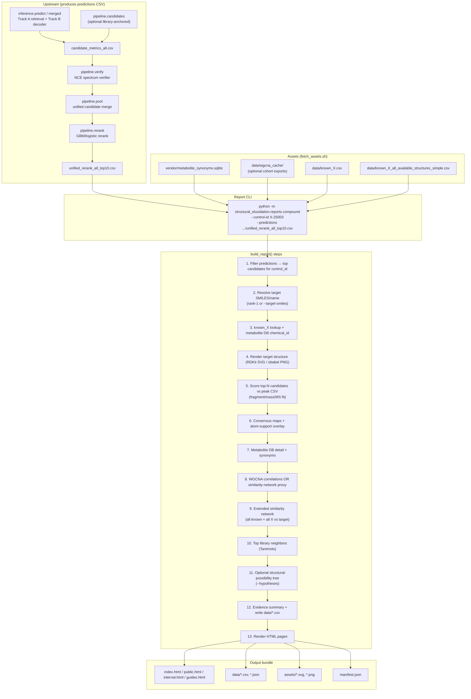

# Compound HTML Report Workflow

End-to-end flow from pipeline outputs to a self-contained report bundle for any X compound.

## Overview

The report builder (`structural_elucidation.reports.compound`) does **not** run encoder/decoder inference or reranking. It takes an existing ranked predictions CSV and produces a self-contained HTML bundle with supporting data files, structure images, similarity networks, and optional WGCNA correlation context.



---

## Phase 0 — Get a predictions file

The report needs a **ranked candidate CSV** for one X compound. Typical source after `run_inference.sh`:

```
output/pipeline_equalization/rerank_lib209/unified_rerank_all_top10.csv
```

That file comes from: optional library-anchored candidates → verifier → unified pool → rerank.

Alternatively, use any compatible pool or rerank CSV with `control_id`, `predicted_smiles`, and `rank`.

### Upstream paths (for context)

| Stage | Module | What it does |
|-------|--------|--------------|
| Inference (optional) | `inference.predict` / `inference.merged` | Encoder + retrieval (Track A) + decoder (Track B) → candidate metrics |
| Library-anchored (optional) | `pipeline.candidates` | HMDB/NCE mass-match candidates (no neural models) |
| Verifier | `pipeline.verify` | NCE predicted-spectrum scoring |
| Pool | `pipeline.pool` | Merge verifier output with base unified pool |
| Rerank | `pipeline.rerank` | GBM/logistic cross-source rerank → final top-10 CSVs |

---

## Phase 1 — Fetch optional assets

```bash
./fetch_assets.sh --source local --parent ../
# or
./fetch_assets.sh --source ec2 --host user@your-ec2-host
```

| Asset | Role in report |
|-------|----------------|
| `vendor/metabolite_synonyms.sqlite` | Library matches, synonyms, pathways, similarity neighbors |
| `data/known_X.csv` | Ground-truth / metadata row for the X compound (shipped) |
| `data/known_X_all_available_structures_simple.csv` | Extended unknown-X similarity network (shipped) |
| `data/wgcna_cache/` *(optional)* | Real top-correlating metabolites (HELIOS, Twins_UK, PRIMM cohorts) |

Missing DB or WGCNA cache → report still builds; those sections use placeholders or are omitted.

---

## Phase 2 — Run the report builder

```bash
cd /path/to/spec2mol_inference

pip install -e .   # if not already installed

python -m structural_elucidation.reports.compound \
  --control-id X-25003 \
  --predictions output/pipeline_equalization/rerank_lib209/unified_rerank_all_top10.csv \
  --out-dir output/reports/X-25003
```

### CLI arguments

**Required**

| Flag | Description |
|------|-------------|
| `--control-id` | X compound id, e.g. `X-25003` |
| `--predictions` | Rerank or candidate-pool CSV |

**Optional (enrich sections)**

| Flag | Description |
|------|-------------|
| `--out-dir` | Output directory (default: `output/reports`) |
| `--candidate-pool` | Full candidate pool instead of deriving from predictions |
| `--peak-csv` | Observed peaks for fragment/mass/MS fit scoring |
| `--hypotheses` | Structural-possibility tree input |
| `--target-smiles` | Override rank-1 target SMILES |
| `--target-name` | Override display name |
| `--chemical-id` | Override metabolite DB chemical id |
| `--db` | Metabolite synonyms SQLite (default: `vendor/metabolite_synonyms.sqlite`) |
| `--known-x` | known_X table (default: `data/known_X.csv`) |
| `--known-x-all` | All known X structures (default: `data/known_X_all_available_structures_simple.csv`) |

**Tuning flags** (defaults match X-25003 template): `--spectrum-tolerance-da`, `--min-similarity`, `--max-neighbors`, `--candidate-tab-n`, `--consensus-top-n`, extended-network thresholds.

---

## Phase 3 — What `build_report()` computes

| Step | Output data | HTML section |
|------|-------------|--------------|
| Filter & rank candidates | `{slug}_top_candidates.csv` | Top 10 structures |
| Spectrum alignment vs peaks | `{slug}_candidate_score_summary.csv` | Fragment / mass / MS fit scores |
| Substructure consensus | `{slug}_candidate_consensus_maps.json`, consensus SVG | Atom-support overlay |
| known_X row | `{slug}_known_x_row.csv` | Target metadata |
| Metabolite DB | `metabolite_db_detail.csv`, `metabolite_db_synonyms.csv` | Library matches, synonyms |
| WGCNA or proxy | `{slug}_top_correlating_metabolites.csv` | Top correlating metabolites |
| Extended network | `extended_similarity_network.*`, `all_known/unknown_similarity_*.csv` | Expanded similarity graph |
| DB neighbors | `similarity_neighbors.csv` | Top 10 library matches |
| Hypotheses *(optional)* | `{slug}_structural_possibility_summary.csv` | Structural possibility tree |
| Evidence rollup | `{slug}_evidence_summary.csv/json` | Confidence parameters |

WGCNA lookup searches cohort exports under `data/wgcna_cache/` (HELIOS, Twins_UK, PRIMM_feces, PRIMM_serum). If no match is found, placeholder correlation rows are built from nearest verified X-structure neighbors in the extended similarity network.

---

## Deep dive: structure rendering

### Target structure (SVG)

1. **`render_smiles_svg(smiles)`** is the primary path:
   - Calls **Open Babel** (`obabel -:SMILES -omol --gen2d`) via subprocess to generate a V2000 mol block with 2D coordinates.
   - Parses the mol block into atoms (x, y, element) and bonds (atom indices, bond order).
   - Renders a custom SVG directly from the coordinate data — single/double/triple bonds drawn with parallel-offset geometry, element labels colored by atom type (N=blue, O=red, S=gold, P=orange, halogens=green/brown/purple), line widths proportional to a target bond length of 36px.
   - Falls back gracefully: if Open Babel is missing → returns `None` and the report uses `structure_image()` (RDKit PNG) instead.

2. **`structure_image(smiles, path)`** (fallback):
   - Uses `RDKit.Chem.Draw.MolToFile()` to render a 520×360 PNG.

### Neighbor structure images

For each top-N similarity neighbor, `structure_image()` produces a labeled PNG in `assets/neighbor-{chemical_id}-{slugified_name}.png`.

---

## Deep dive: candidate scoring (`score_smiles_spectrum_alignment`)

When `--peak-csv` is provided, each candidate SMILES is scored against the observed MS2 peaks:

1. **Fragment generation** (`candidate_fragment_and_loss_masses`):
   - Uses RDKit `FragmentOnBonds()` to cleave every non-ring single bond in the candidate molecule.
   - Collects exact masses of all resulting fragments (≥10 Da, ≤parent−1 Da) and their complementary neutral losses.

2. **Matching against observed peaks**:
   - Each observed peak m/z is checked against predicted fragment ion masses within `--spectrum-tolerance-da` (default 1.0 Da).
   - Each observed neutral loss (= parent neutral mass − peak m/z) is checked against predicted loss masses.
   - Matches are intensity-weighted (base-peak normalization).

3. **Scoring**:
   - `spectrum_fragment_ion_score` = Σ(matched-ion-weights) / Σ(all-peak-weights)
   - `spectrum_neutral_loss_score` = same for neutral-loss matches
   - `smiles_spectrum_alignment_score` = 0.55 × ion_score + 0.45 × loss_score

---

## Deep dive: consensus atom-support heatmap

`consensus_atom_support(reference_smiles, top_N_candidates)` produces a per-atom confidence overlay:

1. Takes the rank-1 target as the reference molecule.
2. For each of the top-N candidates, runs **RDKit MCS (Maximum Common Substructure)** between reference and candidate (timeout 2s, no valence matching, ring-agnostic).
3. Maps the MCS SMARTS pattern back onto the reference molecule's atoms — every atom in the match gets +1 support count.
4. Normalizes: `confidence[atom] = support_count[atom] / valid_candidate_count`.
5. Renders an inline SVG with:
   - 2D coordinates from `rdDepictor.Compute2DCoords()`.
   - Each atom as a circle colored by a blue→amber→red heatmap (0.0 → 0.5 → 1.0).
   - Bond skeleton drawn with semi-transparent navy lines.
   - Per-atom confidence labels below each circle.

Output: `{slug}_consensus_atom_support.csv` (per-atom breakdown) + embedded SVG in the HTML.

---

## Deep dive: similarity networks

### Similarity metric

All pairwise similarities use **Morgan fingerprints (radius=2, 2048 bits)** via RDKit `rdFingerprintGenerator.GetMorganGenerator()`, measured with **Tanimoto coefficient**.

### Extended similarity network (`build_extended_similarity_network`)

1. **Known metabolites** — queries `metabolite_synonyms.sqlite` for all rows with a SMILES. Computes Tanimoto to target; filters at `--extended-known-min-similarity` (default 0.30), caps at `--extended-known-render-limit` (default 120).
2. **Verified X structures** — reads `known_X_all_available_structures_simple.csv`. Same Tanimoto computation; filters at `--extended-x-min-similarity` (default 0.0, i.e. render all).
3. **Node construction** — each node has: id, label, kind (target/known/unknown), SMILES, similarity_to_target, confidence bucket (high ≥0.75, medium ≥0.50, context), pathway, radius (scaled by similarity), color from a warm ramp.

### Edge generation (`build_pairwise_similarity_edges`)

- Computes **all-pairs Tanimoto** between nodes.
- Edges to target: kept if similarity ≥ `--extended-target-edge-min` (default 0.32).
- Edges between non-target pairs: kept if similarity ≥ `--extended-pair-edge-min` (default 0.42).
- Degree-capped at `--extended-max-edges-per-node` (default 6) to prevent hairball graphs.
- Sorted by similarity descending; greedy selection respects degree caps.

### Layout (`cluster_layout_network`)

1. **Union-find clustering** on non-target pairwise edges above a `cluster_threshold` (default 0.50).
2. **Concentric ring placement** — target cluster goes to canvas center; remaining clusters are placed in concentric rings (first ring radius 185px, each subsequent ring +118px, capacity growing 8 nodes/ring).
3. **Intra-cluster layout** — medoid (highest internal-similarity node) placed at cluster center; other members radially arranged by similarity to medoid (closer = higher similarity), with a slight elliptical compression (y-scale 0.86).
4. **Spring-refinement** — after initial placement, a light force-directed pass (not full simulation, just degree-based offset) resolves node overlaps.
5. Writes `x`, `y` into each node dict for the SVG renderer.

### SVG rendering (`extended_network_svg`)

- Viewbox 1680×1180.
- Edges: `<line>` elements with stroke opacity proportional to similarity (0.08 base + sim×0.18), width (0.7 + sim×1.8).
- Nodes: `<g>` groups with `<circle>` (radius from layout, fill from color ramp, stroke by kind) + optional display label `<text>`.
- Data attributes on every element for potential JS interactivity (hover tooltips with name, kind, similarity, pathway).

### Color ramp

| Tanimoto | Color | Label |
|----------|-------|-------|
| ≥ 0.60 | `#D73A49` (red) | high |
| ≥ 0.50 | `#F28E2B` (amber) | medium |
| ≥ 0.40 | `#59A14F` (green) | moderate |
| < 0.40 | `#4E79A7` (blue) | context |
| Target | `#001D37` (navy) | — |

---

## Deep dive: WGCNA correlation lookup

`load_real_correlation_rows(control_id, chemical_id, target_name)` searches configured cohort exports:

| Cohort | Module file | Correlation matrix |
|--------|------------|-------------------|
| HELIOS | `WGCNA_HELIOS_all_6_0.25_3.csv` | `full_correlation_matrix.csv` |
| Twins_UK | `WGCNA_Twins_UK_2420_5_0.25_3.csv` | `corrMatrix.csv` |
| PRIMM_feces | `WGCNA_PRIMMfull_feces_23920_5_0.25_3.xlsx` | `corrTN_...xlsx` |
| PRIMM_serum | `WGCNA_PRIMMfull_serum_23629_5_0.25_3_withUnkInfo.xlsx` | `corrTN_...xlsx` |
** ADD CLSA **
Matches by `plot_name` (control_id or target_name) or `chem_id` (chemical_id). If found, returns real top-correlating metabolites from the shared WGCNA module.

If no match in any cohort → builds **proxy correlation rows** from the top-5 nearest verified X-structure neighbors in the extended similarity network, using Tanimoto as a stand-in for correlation_r.

---

## Output bundle

```
output/reports/X-25003/
├── index.html              # same as public.html
├── public.html
├── internal.html
├── guides.html
├── X_25003.html            # alias of public.html
├── manifest.json
├── assets/
│   ├── x-25003_structure.svg
│   └── neighbor-*.png
└── data/
    ├── x-25003_top_candidates.csv
    ├── x-25003_candidate_score_summary.csv
    ├── x-25003_candidate_consensus_maps.json
    ├── x-25003_consensus_atom_support.csv
    ├── x-25003_known_x_row.csv
    ├── metabolite_db_detail.csv
    ├── metabolite_db_synonyms.csv
    ├── similarity_neighbors.csv
    ├── similarity_network.json
    ├── extended_similarity_network.json
    ├── all_known_similarity_to_x-25003.csv
    ├── all_unknown_similarity_to_x-25003.csv
    ├── x-25003_evidence_summary.csv
    ├── x-25003_top_correlating_metabolites.csv
    └── ...
```

---

## Minimal vs full report

| Tier | Inputs | What you get |
|------|--------|--------------|
| **Minimal** | `--control-id` + `--predictions` + shipped `known_X` | Candidates, structures, basic evidence; DB/network sections degraded |
| **Standard** | + `metabolite_synonyms.sqlite` + `known_X_all` | Library matches, neighbors, full similarity networks |
| **Full** | + `--peak-csv` + `wgcna_cache` + `--hypotheses` | Real MS scoring, WGCNA correlations, structural-possibility tree |

---

## One-line mental model

**Predictions CSV in → enrich with metabolite DB, known-X tables, optional peaks/WGCNA → compute scores, networks, consensus → self-contained HTML bundle out.**

---

## Related commands

```bash
# Smoke test (includes report module import)
pytest tests/test_smoke.py -m smoke

# Help
python -m structural_elucidation.reports.compound --help
```
