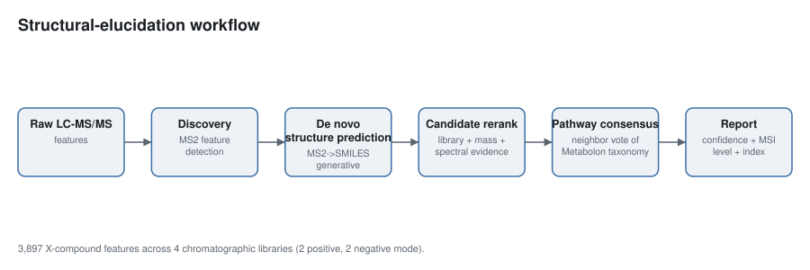
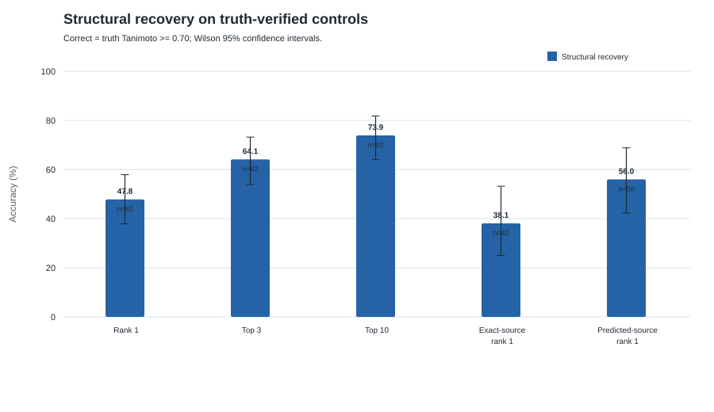
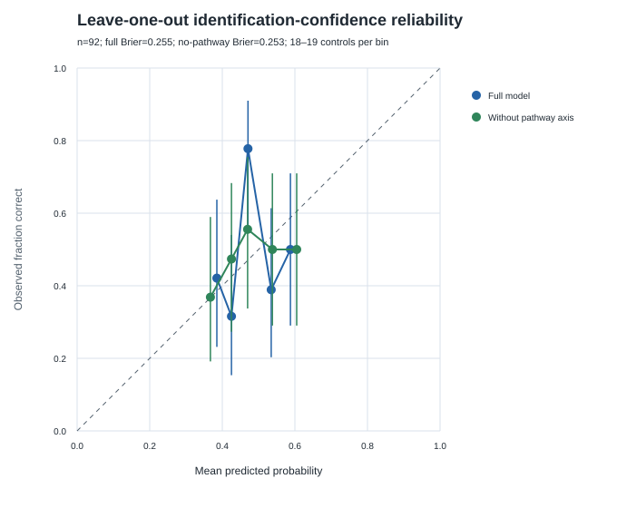
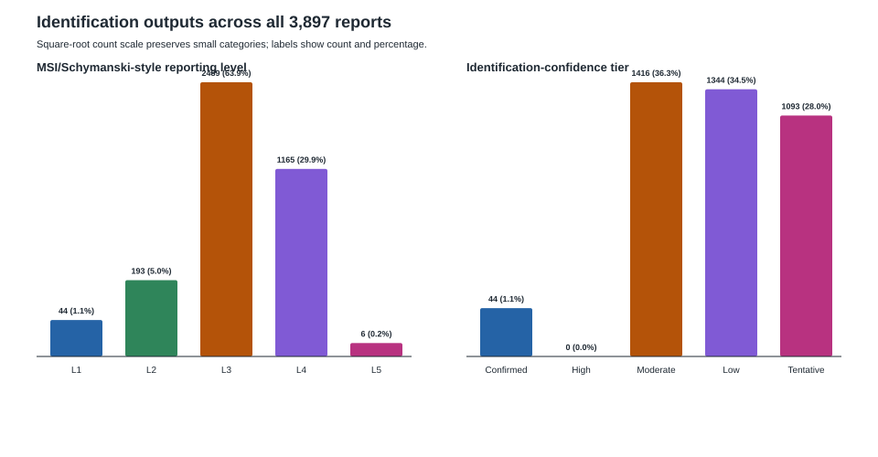
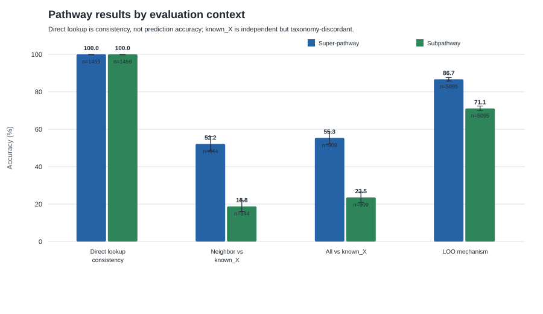
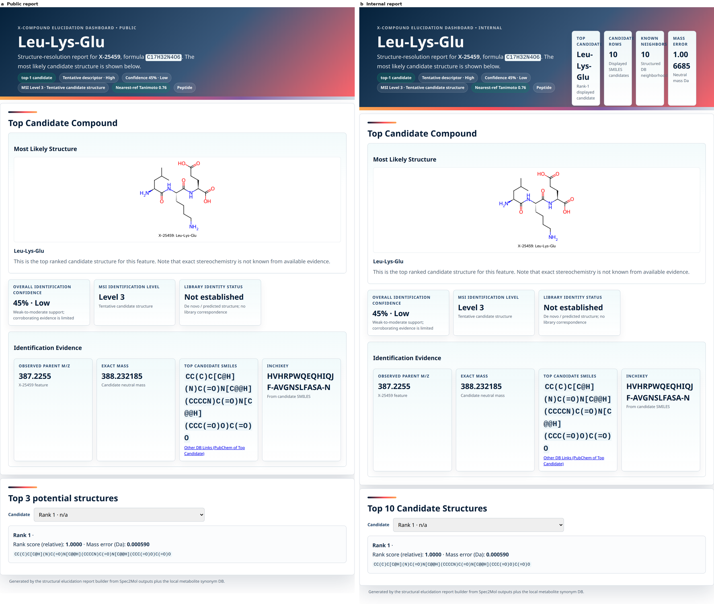

# Evidence-aware reporting of unknown metabolite structure hypotheses

**Authors:** Joshua Simpson1, [additional authors]1
**Affiliation:** 1Metabolon, Inc., Morrisville, NC, USA
**Corresponding author:** [email]

## Abstract

Untargeted LC-MS/MS detects far more reproducible features than can be identified against authentic standards, and the remainder is routinely set aside for want of a comparable confidence statement [1,2]. We evaluated a workflow combining retrieval and de novo candidate generation, evidence-aware reranking, biochemical taxonomy assignment and MSI-style claim control across 3,897 X-compounds. Among 92 truth-verified controls, structural recovery was 47.8% at rank 1 (44/92; 95% CI 37.9–57.9%), 64.1% within the top 3 (59/92; 54.0–73.2%) and 73.9% within the top 10 (68/92; 64.1–81.8%). Leave-one-out validation showed weak aggregate-score calibration (Brier score 0.255), supporting evidence-limited rather than probability-based claims. Taxonomy results separate by provenance: 1,459 direct reference lookups are internally consistent by construction, whereas among 644 neighbor-consensus assignments with independent labels super-pathway agreement was 52.2% (48.3–56.0%) and subpathway agreement 18.8% (15.9–22.0%). Those figures are bounded: on identical structures the two taxonomies agree only 62.5% and 34.8%. Intrinsic leave-one-out validation of the neighbor-vote mechanism yielded 86.7% and 71.1%. The contribution is therefore not higher accuracy but a reporting framework that grades every feature, exposes the provenance of each claim, and withholds a structure when corroboration is insufficient, making the unidentified fraction usable instead of discarded.

---

## 1. Introduction

Untargeted LC-MS/MS metabolomics detects far more reproducible features than can be identified with authentic chemical standards. The unidentified remainder ("unknowns") carries substantial biological information, but communicating *how confident* an identification is—and *what kind* of identification it is—remains a central challenge [1,2]. The Metabolomics Standards Initiative (MSI) [2] and the Schymanski confidence scheme [1] formalized this as a small number of identification levels, from an exact-mass-only "level of interest" up to a standard-confirmed structure.

Matching an observed spectrum against a reference library is the established route to an identification and the most precise one available short of an authentic standard, which is why it accounts for the named fraction of an untargeted deliverable and remains the first step of the workflow reported here. What bounds it is coverage rather than performance: a structure absent from the library is outside the space a library search returns, so extending the named fraction has meant manual chemistry followed by purchase or synthesis of candidate standards, at a throughput that limits both library expansion and the discovery of dataset-specific metabolites [14].

A second failure mode runs in the opposite direction and is the more consequential of the two for how results are read. Matching every detected signal against a broad compound database and reporting the returned names inflates an annotation list without adding identifications. Three mechanisms drive the inflation, and they compound: redundant features arising from multiple adducts and isotopologues of one compound are each annotated separately; the same compound is counted again where it is detected by more than one chromatographic method; and matches are admitted with no similarity floor that would distinguish a corroborated call from a coincidence of mass. The resulting count is not a measure of coverage, and because the list carries no graded statement of what stands behind each entry, the burden of separating the supported entries from the rest is transferred to a reader with less information than the workflow had. Reported annotation totals are therefore not comparable between workflows unless the redundancy and admission criteria behind them are stated.

To extend candidate generation past the coverage boundary without incurring that inflation, published approaches including MS2Query, SIRIUS, Spec2Mol, and MSNovelist were assessed using the Critical Assessment of Small Molecule Identification (CASMI) framework [12,13]. The workflow evaluated here builds on Spec2Mol-style de novo generation and adds retrieval, evidence-aware reranking, confidence reporting, MSI-style claim control, and neighbor-based biochemical taxonomy assignment. Its deduplication, adduct-aware mass gating and claim-control rules are described in Methods, and Section 3.1 reports what they cost in presented coverage.

We present a workflow that (i) predicts candidate structures for each unknown feature from its MS1/MS2 evidence, (ii) reranks candidates using library, mass, and spectral evidence, (iii) assigns a pathway and subpathway by consensus over structurally similar reference metabolites, and (iv) renders a per-compound report with an aggregate evidence score and an evidence-derived MSI-style reporting level. Our contributions are:

1. **Rank-aware structural validation** with uncertainty, source-stratified recovery, and cross-validated confidence diagnostics.
2. **Provenance-aware taxonomy evaluation** that separates direct database lookup, neighbor consensus, and agreement with independent labels.
3. **Evidence-limited reporting for every feature**, with an MSI-style rubric that presents structure hypotheses only when minimum corroboration criteria are met.

Taken together, these change what an analyst can do with the unidentified fraction of a study. Rather than selecting a handful of features for manual interpretation, every feature can be ranked, placed in a biochemical context, and triaged against the same evidence standard, so the decision of where to spend confirmation effort rests on a comparable basis across the dataset.

*Figure 1. Evidence generation, ranking, taxonomy assignment and claim control are separable stages with distinct failure modes, so each result below can be attributed to a specific stage rather than to the pipeline as a whole. Discovery detects reproducible MS2 features; retrieval/de novo inference proposes candidate structures; reranking orders candidates by library/mass/spectral evidence; taxonomy is assigned by direct lookup or neighbor consensus; and the reporting layer computes an exploratory evidence score and an MSI-style reporting level.*

### 1.1 Toolkit landscape (related work)

Recent MS/MS structure-elucidation tools span a spectrum from library retrieval to de novo generation, and the two ends answer different questions rather than competing on one. **MS2Query** [8] performs analogue and exact-match search against a pretrained GNPS-based library, ranking candidates by a learned chemical-similarity score combined with precursor mass; it is well suited to library expansion, and its coverage is set by its reference library. **SIRIUS 4** [7] deterministically assigns molecular formulae from high-resolution isotope patterns and fragmentation trees (with the ZODIAC option for compounds >500 Da), predicts molecular fingerprints via CSI:FingerID, and assigns compound classes via CANOPUS [9]. **Spec2Mol** [10] is an encoder–decoder—analogous to speech-to-text—that reconstructs SMILES directly from spectra, so its candidate space is defined by the decoder rather than by database membership. **MSNovelist** [11] couples CSI:FingerID fingerprints with an encoder–decoder generator, likewise scoring independently of spectral-library membership and strong on poorly represented structural classes. The generative route trades the precision a library match confers where the compound is catalogued for reach into chemistry that is not, which is why the pipeline reported here runs both: it builds on the **Spec2Mol de novo lineage** and adds retrieval, evidence-aware reranking, exploratory evidence aggregation, MSI-style claim control, and pathway consensus. Because none of these tools has been benchmarked head to head against the present workflow, no accuracy comparison is made; the defensible statement is that combining the retrieval and generative routes provides additional evidence per candidate and reduces dependence on any single evidence source. Substructure-only tools (e.g., MS2LDA [15]) are complementary future work.

One property is worth separating from accuracy, because it governs how any of these outputs can be used. Each route attaches some number to a candidate — a learned similarity, a fingerprint posterior, a rank — and what that number is on the scale of, and what it was checked against, is reported unevenly. A score can be a good ranking device and a poor probability, and the two are not interchangeable for a reader deciding where to spend confirmation effort. This is a reporting gap rather than a defect in the methods, and it is the one this work sets out not to repeat: Section 3.3 states what the score reported here was validated against and what that validation showed, including the leave-one-out result that it orders candidates within a feature but does not separate one feature from another. Publishing the limits of a score is what makes it usable rather than decorative.

---

## 2. Methods

### 2.1 Dataset

The delivered evaluation set comprises **3,897 unique X-compound features** from four internal chromatographic libraries: library 209 (negative ion, n=2,389), library 305 (negative ion, n=202), library 400 (positive ion, n=875), and library 402 (positive ion, n=431). A control present in more than one library was retained from the first library in that order (“first-library-wins”). Each report contains a discovery-derived consensus MS2 record and, where available, an observed precursor m/z and neutral-mass hypothesis. The reporting bundle does not retain specimen-level matrix, species, study-design, or original consent/IRB metadata; these are required from the source studies before journal submission.

Three non-random evaluation subsets are distinguished. Structural recovery is evaluated on all **92 controls with a nonzero truth Tanimoto value** in the delivered candidate files. Independent taxonomy agreement is evaluated on **909 controls** with nonempty `known_X` super-/subpathway labels. Reference-taxonomy consistency is evaluated on **1,466 rank-1 structures** whose InChIKey skeleton occurs in the pathway reference database; 1,459 of these are direct database lookups. Selection into each subset depends on truth/reference availability and may introduce spectrum-, library-, and chemical-class bias. Authoritative P0 and P1 cohort analyses require separate source files not included in this bundle and are therefore not substituted with the 92-control set (Supplementary Methods).

The earlier internal toolkit-benchmarking design—Library 1 (2,091 known serum/plasma metabolites spanning 9 super-pathways and 135 subpathways) and Library 2 (120 internally confirmed NMD/X-compounds plus 500 CASMI 2022 compounds)—is described in the Supplementary Information as prospective validation. Its counts are not pooled with the deployed 3,897-feature evaluation.

### 2.2 Workflow

Discovery detects reproducible precursor features and aggregates their MS2 scans into consensus spectra. The Spec2Mol-lineage inference stack uses two complementary tracks. Track A performs cosine-nearest-neighbor retrieval from a structure embedding bank under progressive precursor-mass gates (0.05, 0.5, and 1.0 Da). Track B performs mass-conditioned—and optionally retention-index-conditioned—de novo decoding of SMILES, followed by adduct-aware mass gating. The default merge policy protects high-confidence retrieval rank 1 and jointly orders the remaining retrieval and de novo candidates; up to 10 structures per feature are retained.

The unified reranker is a shallow gradient-boosted or logistic classifier trained on candidate-level labels defined by truth Tanimoto ≥0.70, with leave-one-control-out model diagnostics and source-specific isotonic calibration. Inputs include predicted-spectrum, mass-match, formula-prior, evidence-confidence, MS2-match, NCE, forward-spectrum, generation/novelty, source-rank/density, peptide/library/biotransformation flags, and isotope/carbon-agreement features. The displayed raw “rank score” is an ordering score, not a probability of structural correctness; the separate evidence-confidence field summarizes library, mass, and spectral corroboration.

The delivered artifacts identify the pipeline lineage as `pipeline_equalization_v21_clean_peptide_corrected_v1`. Exact encoder/decoder checkpoint hashes, training-set snapshots, random seeds, CUDA/PyTorch versions, and EC2 hardware were not preserved in the report bundle and must be recovered from the inference run metadata before final submission. The reporting workflow then assigns pathway labels, computes identification confidence/MSI level, and renders one public and one internal HTML report per compound plus a searchable master index.

### 2.3 Pathway and subpathway prediction

Pathway assignment follows two routes. If the rank-1 canonical SMILES exactly matches a labeled reference structure, the corresponding Metabolon super-pathway and subpathway are copied directly (high pathway confidence, vote share 1.0). Otherwise, the production workflow imports a legacy similarity-weighted neighbor-consensus builder and records the nearest-reference similarity, vote share, assignment status, and **pathway-confidence tier** (high/medium/low). The report bundle does not preserve that external builder's exact neighbor count, similarity floor, weighting exponent, molecular-weight priors, SMARTS rules, or amino-acid overrides; these are required provenance inputs. The independently reproducible mechanism-level evaluation in this study uses Morgan radius-2, 2,048-bit fingerprints [5,6], k=10 neighbors, Tanimoto floor 0.30, and similarity-squared vote weights.

### 2.4 Identification-confidence model

The exploratory identification-confidence score combines four available-evidence axes with prespecified weights: structure similarity 0.40, mass/formula match 0.30, MS2 fragment fit 0.20, and pathway consensus 0.10. Scores are divided by the sum of available weights. A one-dimensional Platt model [3] (A=1.887, B=−1.520) was originally fit in-sample on the 92 truth-verified controls (base rate 0.478), then mapped to identification-confidence tiers at 0.65 (High), 0.48 (Moderate), and 0.38 (Low), with mass mismatch forcing Tentative. For publication validation, probabilities were recomputed by leave-one-control-out Platt fitting and evaluated by Brier score, calibration slope/intercept, and reliability bins; an ablation omitted the pathway axis. Given the small, selected truth set and poor cross-validated calibration reported below, the score is presented as exploratory evidence aggregation rather than an externally validated absolute probability.

### 2.5 MSI identification levels

Every report is assigned an evidence-derived Schymanski/MSI-style level (1–5): **L1** authentic-standard confirmation with a truth-matching top candidate; **L2** strong structural similarity (≥0.70), observed-MS2 fit (≥0.30), and strong mass fit (≥0.90); **L3** a mass-consistent structure hypothesis with similarity ≥0.45; **L4** molecular formula/observed mass with no adequately supported structure or a mass-rejected top candidate; and **L5** exact mass only. Levels 1–3 present a structure; levels 4–5 withhold it. These thresholds are a custom reporting rubric, not an externally validated MSI classifier; the independently assigned Metabolon Level is displayed as a cross-reference.

### 2.6 Evaluation and reproducibility

Terms that carry a specific sense in this paper are defined in the Glossary, which closes the document. Four of them are load-bearing here: *recovery*, *accuracy*, *agreement*, and *consistency* name four different measurements, and the distinction between them is what separates a validated result below from a circular one.

Structural recovery is reported at rank 1, top 3, and top 10 for truth-Tanimoto thresholds 0.50, 0.70, 0.85, and exact 2D structure; Tanimoto ≥0.70 is the prespecified primary threshold. Binomial proportions use Wilson 95% confidence intervals, and subgroup median similarities use 2,000 deterministic bootstrap replicates. Calibration uses leave-one-control-out Platt fitting. Authoritative P0/P1 analyses are not reported because their cohort/truth files were unavailable.

Pathway outputs are evaluated separately as: (a) reference-taxonomy **consistency** for rank-1 structures present in the same database, stratified by direct lookup versus neighbor assignment; (b) agreement with independent `known_X` labels, stratified by assignment route, reference membership, pathway-confidence tier, status, and similarity; and (c) intrinsic leave-one-out validation of the neighbor-vote mechanism over 5,095 reference metabolites. Wilson 95% intervals are reported. The leave-one-out result does not validate the full production predictor's external priors/overrides.

Following CASMI [12], four identification categories are considered in increasing importance: (1) adduct annotation, (2) elemental formula, (3) compound/structure class, and (4) 2D chemical structure—with 2D structure as the primary metric, scored **rank-independently** (a correct call means the true structure appears among a tool's top-k candidates). Here, the 2D-structure category maps to structural recovery and the structure-class category to biochemical taxonomy assignment; adduct- and formula-level accuracy were not independently benchmarked and are reserved for the prospective four-toolkit study.

### 2.7 Software and reproducibility

The final delivered reports were produced with eight report-generation workers from four per-library rerank CSVs (3,897 generated; no failures; elapsed time 2,864.84 s). Evidence was subsequently enriched from observed-m/z, observed-MS2, synonym, Metabolon-Level, and WGCNA sidecars, followed by idempotent HTML patches for confidence, candidate-score labeling, and consensus-glyph spacing. Public reports exclude observed fragment-ion detail (audited leaks=0); internal reports retain aggregate MS2 evidence. Compact audit JSON/CSV artifacts, source hashes, and a one-command regeneration script accompany the manuscript. The complete inference environment and proprietary spectra/reference database require controlled-access deposition.

---

## 3. Results

### 3.1 Coverage

The workflow produces an evidence report and a biochemical taxonomy assignment for all 3,897 features. It presents a specific structure for the 2,726 L1–L3 reports (70.0%) and withholds one for the 1,171 L4–L5 reports (30.0%). Pathway provenance is direct reference lookup for 1,459 reports and neighbor consensus for 2,438. Resolving that split by assignment status gives exact reference match 1,459, strong-similarity vote 1,995, and weak-similarity backfill 443; **pathway-confidence tiers** are high 1,863 / medium 616 / low 1,418. The best-reference similarity has median 0.733 (p10 0.375, p90 1.0). Evidence availability is summarized in Supplementary Table S1. Coverage is therefore complete by construction: what differs between features is not whether a result exists but how much that result claims.

### 3.2 Structural recovery

On the 92 truth-verified controls, recovery at Tanimoto ≥0.70 is **47.8% at rank 1** (44/92; 95% CI 37.9–57.9%), **64.1% within the top 3** (59/92; 54.0–73.2%), and **73.9% within the top 10** (68/92; 64.1–81.8%; Figure 2). Rank-1 recovery is 38.1% for exact-catalog-source calls (16/42; 25.0–53.2%; median truth Tanimoto 0.506) and 56.0% for predicted-source calls (28/50; 42.3–68.8%; median 0.811). The intervals overlap, so this cohort does not resolve a difference between the two sources in either direction, and no equivalence claim is made either. What follows is narrower, and concerns how a report's source field should be read rather than how a library match performs: a candidate carrying an exact catalog source has been matched to a catalogued structure, which records where the candidate came from and is not on its own the independent corroboration an authentic standard supplies. The gap between rank-1 and top-10 recovery is itself the argument for reporting a ranked list rather than a single call, because a substantial share of correct structures are present but not first. Threshold-sensitivity results are provided in Supplementary Table S3.

*Figure 2. Recovery improves substantially from rank 1 to top 10, which justifies reporting ranked hypotheses, and the two source subgroups have overlapping intervals on a cohort of this size, which is why an exact-source call is not read as a confirmed one. Structural recovery on 92 truth-verified controls; correctness is truth Tanimoto ≥0.70; error bars are Wilson 95% confidence intervals. “Exact source” records where a candidate came from and is not authentic-standard confirmation.*

### 3.3 Confidence tiers and MSI levels

The in-sample aggregate confidence has median 0.432 (p10 0.372, p90 0.585), but leave-one-control-out Platt validation reveals poor calibration: Brier score 0.255, calibration slope 0.056, and intercept −0.082 (Figure 3). Removing the pathway axis slightly improves Brier score to 0.253 and slope to 0.274. The aggregate score is therefore exploratory and should not be interpreted as a validated absolute probability. Selective prediction shows the practical consequence: ranking the 92 controls by leave-one-out confidence and scoring successively larger prefixes leaves rank-1 recovery essentially unchanged, at 50.0% for the most confident fifth against 47.8% for the whole cohort (Supplementary Figure S5). The score therefore does not order one feature against another, which is a stronger and more useful statement than poor calibration alone.

*Figure 3. The aggregate score is poorly calibrated out of sample, which is the evidence for presenting it as an ordering device rather than a probability of structural correctness. Mean leave-one-out predicted probability versus observed structural correctness in five equal-count bins (n=92); error bars are Wilson 95% confidence intervals and the dashed line is perfect calibration.*

The **identification-confidence tier** distribution is Confirmed 44 / High 0 / Moderate 1,416 / Low 1,344 / Tentative 1,093. Separately, the MSI-style reporting distribution is L1 44 / L2 193 / L3 2,489 / L4 1,165 / L5 6 (Figure 4). L4–L5 withhold a specific structure. These custom thresholds require external validation; their cross-tabulation is reported in Supplementary Table S2.

*Figure 4. The rubric concentrates results in hypothesis-level categories and leaves the strongest confidence tier empty, showing that the claim-control rules bind in practice rather than only in principle. Counts and percentages across all 3,897 reports; a square-root count scale preserves small categories, and the “High” identification-confidence tier is explicitly shown as empty.*

### 3.4 Biochemical taxonomy assignment

The delivered reports use two assignment routes that must be evaluated separately. For 1,459 compounds, an exact structure match triggers direct lookup of the reference-database taxonomy; these assignments are 100% internally consistent (95% CI 99.7–100.0%) by construction and are **not an independent prediction-accuracy estimate**. The remaining 2,438 reports use neighbor consensus. Among 644 neighbor-consensus controls with independent `known_X` labels, super-pathway agreement is **52.2%** (336/644; 95% CI 48.3–56.0%) and subpathway agreement is **18.8%** (121/644; 15.9–22.0%); across all 909 labelled controls, direct lookups included, the figures are 55.3% (503/909; 52.1–58.5%) and 23.5% (214/909; 20.9–26.4%). An intrinsic leave-one-out test of the neighbor-vote mechanism over 5,095 reference metabolites yields 86.7% super-pathway (4,417/5,095; 95% CI 85.7–87.6%) and 71.1% subpathway accuracy (3,623/5,095; 69.9–72.3%), but does not include all production priors and overrides (Figure 5, Table 1).

*Figure 5. Apparent pathway performance depends entirely on the evaluation context, so quoting a single pathway figure without its provenance would misstate the result by tens of percentage points. Direct lookup measures taxonomy consistency; `known_X` is an independent but discordant label source; LOO validates only the neighbor-vote mechanism. Error bars are Wilson 95% confidence intervals.*

**Table 1. Pathway and subpathway results by evaluation context.**

| Evaluation | n | Super (95% CI) | Sub (95% CI) |
|---|---|---|---|
| Reference taxonomy, direct lookup (consistency only) | 1,459 | 100.0% (99.7–100.0%) | 100.0% (99.7–100.0%) |
| Neighbor consensus vs independent `known_X` | 644 | 52.2% (48.3–56.0%) | 18.8% (15.9–22.0%) |
| All assignments vs independent `known_X` | 909 | 55.3% (52.1–58.5%) | 23.5% (20.9–26.4%) |
| Neighbor-vote leave-one-out mechanism | 5,095 | 86.7% (85.7–87.6%) | 71.1% (69.9–72.3%) |

**The independent-label comparison is bounded, and not uniformly.** `known_X` and the reference-database taxonomy are separate annotations of the same chemistry. On 267 controls whose structure is identical to a reference entry, where the label is copied and the assignment is right by construction, the two agree only **62.5%** (167/267; 95% CI 56.6–68.1%) at the super-pathway level and **34.8%** (93/267; 29.4–40.7%) at the subpathway level; dipeptides labeled "Amino Acid" in one taxonomy and "Peptide" in the other are typical. No predictor targeting the reference taxonomy can score above those rates against `known_X`. The bound is not uniform across chemical space, however: the most similar fifth of inferred assignments reaches 80.6% super-pathway agreement, above the rate measured on reference structures.

**Vocabulary corrections move the numerator and the bound together.** Treating amino acid and peptide as one class, a structural continuum whose mutual confusion is the largest single disagreement, raises inferred super-pathway agreement to 59.5% and its bound to 71.5%. Excluding the 181 controls whose independent subpathway label is an internal review note or an explicit non-answer, against which nothing can score, raises subpathway agreement to 23.6% and its bound to 42.7%. Neither correction changes the share of the achievable rate the predictor reaches, which stays near 83% at the super-pathway level and near 55% at the subpathway level. A maximal collapse of the commonly confused classes would reach 93.3%, but it merges four of the eight super-pathways and is reported as a bound only (Supplementary Table S8).

**Agreement varies with evidence, not with library.** Across the three chromatographic libraries carrying enough controls to score, super-pathway agreement is 53.2% (n=464), 43.8% (n=80) and 50.0% (n=84), every interval overlapping at both levels (Supplementary Table S9), so the pooled figures are not an average over dissimilar populations. Structural similarity is a different matter: sorting inferred assignments by best-reference similarity and scoring cumulative prefixes lifts subpathway agreement to 34.1% over the most confident fifth (Supplementary Figure S5), and agreement is monotonic by pathway-confidence tier (high 70.3%, medium 61.4%, low 36.9%; Supplementary Figure S1). Predicted super-pathway frequencies otherwise track `known_X`, with chemically adjacent confusions dominating (Supplementary Tables S6–S7).

### 3.5 Mass-mismatch failure mode

There are **598/3,897 (15.4%)** rank-1 mass mismatches. Of these, 590 fall into the historical MSI-L4 deep-audit subset; the remaining eight are outside L4. A lower-ranked, strongly mass-consistent candidate exists for 523/598 overall and 519/590 in the L4 subset. This identifies a reranking opportunity, **not 523 proven-correct recovered structures**: the alternatives have not undergone post-gate truth validation. Rank-1 errors are often chemically meaningful (median nonzero error ~176 Da), and 248/590 L4 cases lack a computable rank-1 formula. Detailed counts appear in Supplementary Section S5.

### 3.6 The delivered artifact

The reporting rules described above are visible in the rendered output rather than only in the rubric (Figure 6). Each feature yields two pages built from one evidence set: a public page and an internal one. Both carry the same reporting level, the same identification-confidence tier and the same evidence cards, and they differ in how much of the candidate list each is allowed to expose — three structures against ten at Level 3, and none at all at Levels 4–5. The level therefore governs the artifact and not merely the metadata, which is what makes the withheld 1,171 reports a designed outcome rather than an absence.

*Figure 6. The reporting level is enforced in the rendered page, so the difference between the two audiences is what may be shown rather than what was computed. Both panels are the same feature and the same evidence: **a**, the public page; **b**, the internal page, which adds triage metrics to the header and retains ten candidates where the public page shows three. The example is a demonstration control rendered by the report builder from data committed with this manuscript, not a delivered customer result; panels not populated by that reduced input are omitted.*

---

## 4. Discussion

Two results reframe how these outputs should be read. First, **provenance is not by itself confirmation**: exact-catalog-source rank-1 recovery is 38.1% (16/42; 95% CI 25.0–53.2%) on this cohort, so within these reports “exact source” records how a candidate was proposed and does not stand in for authentic-standard confirmation. The original aggregate probability is also poorly calibrated under leave-one-out validation. The defensible reporting mechanism is therefore claim limitation: L3 structures are explicitly hypotheses, while L4–L5 withhold a specific structure. The mass-mismatch cohort shows that mechanism working and its limit at once. Rank-1 calls failing the mass check are demoted to L4 rather than presented, which is the rubric behaving as intended, yet a better mass-matching alternative already sits lower in 523 of those 598 candidate lists, so the ordering is leaving recoverable structures unranked. Claim limitation contains the error; it does not correct it. This aligns with the communication intent of the Schymanski/MSI frameworks [1,2], although the custom thresholds still require external validation.

Second, **taxonomy provenance is inseparable from apparent pathway performance**. Direct reference lookups are internally consistent but do not test prediction, neighbor-consensus agreement with independent labels is materially lower, and mechanism-level leave-one-out is much higher. Part of that spread is annotation rather than prediction, since the two taxonomies agree only 62.5% at the super-pathway level and 34.8% at the subpathway level on identical structures. Correcting the vocabulary raises the observed rate and its bound by similar amounts and leaves the share of the achievable rate unchanged, so the corrections establish what the shortfall is not, without removing it. Because the bound is itself uneven across chemical space, ceiling-normalized figures indicate the size of the annotation effect but do not serve as an exact divisor, and the similarity-stratified curve is the better guide.

The two confidence signals the reports carry behave differently, which governs how each should be used, and both were tested rather than asserted. Pathway similarity orders assignments: between the whole cohort and its most confident fifth it gains 28 percentage points of super-pathway agreement, so withholding the least similar assignments buys agreement at a predictable cost in coverage. Identification confidence gains two points of rank-1 recovery over the same comparison and does not order features at all (Supplementary Figure S5). Prioritization guidance should therefore be offered for pathway assignments and withheld for structural calls, where the useful ordering is between candidates within a feature rather than between features. Reporting that split is the point: a confidence value published without a statement of what it was tested against, and of which comparisons it does not support, cannot be acted on differently from a value that was never tested. Both tests here are reproducible from the committed artifacts, and neither licenses reading the aggregate score as a probability of correctness.

**How a wrong call is kept out of a report.** Control of false positives is distributed across the workflow rather than applied as a final filter, and the four mechanisms are worth stating together because each addresses a different way an unsupported entry reaches a list. Redundancy is removed before scoring: consensus spectra are built per reproducible feature, candidates are gated against the neutral mass implied by an adduct hypothesis rather than the observed *m/z*, isotope and carbon agreement enter the ranking, and a feature detected by more than one chromatographic method is counted once. Admission is then bounded by evidence rather than by rank: a rank-1 candidate failing the mass check is demoted to L4 instead of presented, which happened for 598/3,897 features, and the level rubric withholds a structure entirely for 1,171. The cost is visible and was accepted: 30.0% of the delivered set carries no structure. What this does not do is correct the underlying ordering. A mass-consistent alternative already sits lower in 523 of those 598 candidate lists, so claim limitation is containment rather than repair, and the reranking opportunity it exposes is quantified in Section 3.5 rather than claimed as recovered structures.

Relative to reference-library analogue search (MS2Query), formula/fingerprint methods (SIRIUS/CANOPUS), and de novo generators (Spec2Mol/MSNovelist), this workflow's principal contribution is not a claim of state-of-the-art structural recovery. It is the integration of retrieval and generation with explicit evidence provenance, rank-aware evaluation, and reporting rules that limit unsupported structural claims. Library matching is not displaced by that integration: where a feature corresponds to a catalogued compound it remains the most direct route to an identification and supplies one of the evidence axes the reranker reads, and the workflow is aimed at the features that fall outside current coverage, whose well-corroborated hypotheses are themselves candidates for entering the library. A formal head-to-head benchmark remains necessary; until one exists, the defensible statement is that the workflow provides additional evidence per candidate, increases transparency about what each call rests on, and supports more informed prioritization of which features merit standard acquisition.

### 4.1 Applications

Three uses follow from the results above. Each states what an analyst can do that was previously impractical, the result that supports it, and the limitation that bounds it.

**Triaging unknown features for standard acquisition or synthesis.** Selection can be driven by a ranked shortlist rather than by expert intuition applied to a handful of features: the correct structure fell within the top 10 for 73.9% of truth-verified controls, so a chemist working through a short candidate list does so with a measured prior, not an unknown one. The bound is the control set itself—92 availability-selected compounds—so this is performance on that cohort, not an expected yield on new data.

**Expanding reference coverage.** Well-corroborated hypotheses give a defensible starting point for adding compounds to a reference library, and the MSI-style rubric identifies which reports carry enough corroboration to justify that cost. The bound is that an L3 report remains a hypothesis; promotion still requires authentic-standard confirmation.

**Keeping the unidentified fraction inside biological interpretation.** Because taxonomy is assigned to all 3,897 features, including the 1,171 for which no structure is presented, features associated with a phenotype can be discussed biochemically even when their structure is unresolved. The bound is taxonomy provenance: direct lookups are consistent by construction, neighbor-consensus subpathway agreement with independent labels is low, and pathway-confidence tiers should therefore prioritize rather than settle a classification.

All three depend on the report distinguishing the type of identification, the available corroborating evidence, and the unresolved ambiguity rather than presenting an unqualified structure.

## 5. Limitations

These are the bounds within which the results above hold. Several of them are structural rather than incidental, and two—the calibration cohort and the discordance between the two taxonomies—determine how the corresponding figures may be read at all, so they are stated here in full rather than only beside the results they qualify.

- **Selected, single-organization cohorts.** The 3,897-feature set and each truth subset are availability-selected and imbalanced across libraries. Specimen-level matrix/species metadata are absent from the reporting bundle, limiting generalizability and bias assessment. **[REQUIRED: recover source-study matrix and species metadata so results can be stratified by matrix, and report the per-matrix named fraction before and after this workflow.]**
- **Calibration set size and performance.** The confidence model was originally fit on the same 92 controls used for evaluation. Leave-one-out Brier score (0.255) and calibration slope (0.056) show that absolute probabilities are not externally calibrated; P0/P1 truth files were unavailable.
- **Sparse MS2.** Observed MS2 is present for only 43.6% of features; MS2 is the strongest independent corroboration, so its absence caps confidence. Broader capture and a better candidate-vs-spectrum scorer are needed.
- **Taxonomy evaluation.** Direct reference lookups are circular as accuracy tests. Independent labels are discordant with the reference taxonomy, agreeing only 62.5% at the super-pathway and 34.8% at the subpathway level even on identical structures, so `known_X`-scored results are bounded well below 100%. Minimal vocabulary corrections raise the observed rate and the bound by similar amounts without changing their ratio, and a curated crosswalk over the full subpathway vocabulary has not been attempted. One fifth of the independent subpathway labels are internal review notes or explicit non-answers rather than taxonomy terms, which is a defect in the comparison rather than in the predictor. Neighbor-consensus subpathway agreement is low even against the corrected bound. Production neighbor-builder parameters were not retained in the bundle.
- **Custom MSI-style rubric.** L2–L5 boundaries are operational thresholds and have not been independently validated against a sufficiently large authentic-standard cohort.
- **Co-abundance correlations.** Client-specific WGCNA [4] co-abundance evidence is a placeholder in the current reports (covering 13% of controls) and is not yet an independent confidence axis.
- **Reproducibility constraints.** Proprietary raw spectra, model checkpoints, and the reference database are not publicly deposited; exact run-environment metadata must be recovered before submission.

## 6. Conclusion

The workflow generates a complete evidence report for 3,897 unknown metabolite features and presents a specific structure for 70.0% while withholding one for the remaining 30.0%. Structural recovery reaches 47.8% at rank 1 and 73.9% within the top 10 on a small selected truth set. Pathway output is complete, but direct lookups must be separated from neighbor prediction; independent neighbor-consensus agreement is moderate at the super-pathway level and low at the subpathway level. The central result is therefore a reporting framework that exposes provenance and limits claims, rather than an assertion of uniformly accurate structural or pathway prediction. Its practical consequence is to reframe the unidentified fraction of an untargeted study from a residue that is discarded into a graded, prioritizable set of hypotheses: the workflow does not remove the confirmatory experiment, it indicates which one is worth running.

## 7. Future work

Priorities are external validation on the authoritative P0/P1 cohorts and a larger authentic-standard set; prospective testing of a hard mass gate; improved observed-MS2 coverage and candidate-spectrum scoring; and capture of real co-abundance evidence. A formal CASMI-style comparison of MS2Query, SIRIUS, Spec2Mol, and MSNovelist [8,10,11] across the prespecified benchmarking libraries is needed to support tool-selection claims. Substructure tools such as MS2LDA [15] may provide useful partial identifications when complete structures remain unresolved. Production deployment additionally requires immutable model/data provenance and evaluation of GPU scalability.

## Data and code availability

Per-compound HTML reports, the searchable master index, audit code, compact aggregate audit artifacts, figure-generation tooling, and the exploratory confidence/MSI implementation are versioned in the project repository. Raw proprietary spectra, model checkpoints, and the full reference database require controlled access. **[REQUIRED BEFORE SUBMISSION: add repository release/DOI, software license, controlled-access request process, and immutable report-bundle checksum.]**

## Author contributions

Joshua Simpson: conceptualization, methodology, software, formal analysis, investigation, visualization, and writing—original draft. **[REQUIRED: add all authors and CRediT roles.]**

## Funding

**[REQUIRED: identify internal/external funding or state that no specific funding was received.]**

## Competing interests

The authors are affiliated with Metabolon, Inc. **[REQUIRED: confirm employment/equity and complete the journal-specific disclosure.]**

## Ethics and human subjects

No new biospecimens were collected for this computational study. It reanalyzed derived spectral features and reference-library metadata from prior internal workflows. **[REQUIRED: confirm de-identification and the consent/IRB or exemption governing the source studies before submission.]**

## Acknowledgments

**[REQUIRED: acknowledge data-generation, curation, chemistry, and computational-infrastructure contributors.]**

## References

1. Schymanski EL, Jeon J, Gulde R, Fenner K, Ruff M, Singer HP, Hollender J. Identifying Small Molecules via High Resolution Mass Spectrometry: Communicating Confidence. *Environ. Sci. Technol.* 2014, 48(4):2097–2098.
2. Sumner LW, Amberg A, Barrett D, et al. Proposed minimum reporting standards for chemical analysis (Metabolomics Standards Initiative). *Metabolomics* 2007, 3:211–221.
3. Platt J. Probabilistic outputs for support vector machines and comparisons to regularized likelihood methods. *Advances in Large Margin Classifiers* 1999, 61–74.
4. Langfelder P, Horvath S. WGCNA: an R package for weighted correlation network analysis. *BMC Bioinformatics* 2008, 9:559.
5. Landrum G, et al. RDKit: Open-source cheminformatics. https://www.rdkit.org.
6. Bajusz D, Rácz A, Héberger K. Why is Tanimoto index an appropriate choice for fingerprint-based similarity calculations? *J. Cheminform.* 2015, 7:20.
7. Dührkop K, Fleischauer M, Ludwig M, et al. SIRIUS 4: a rapid tool for turning tandem mass spectra into metabolite structure information. *Nat. Methods* 2019, 16:299–302.
8. de Jonge NF, Louwen JJR, Chekmeneva E, et al. MS2Query: reliable and scalable MS2 mass spectra-based analogue search. *Nat. Commun.* 2023, 14:1752.
9. Dührkop K, Nothias L-F, Fleischauer M, et al. Systematic classification of unknown metabolites using high-resolution fragmentation mass spectra (CANOPUS). *Nat. Biotechnol.* 2021, 39:462–471.
10. Litsa EE, Chenthamarakshan V, Das P, Kavraki LE. An end-to-end deep learning framework for translating mass spectra to de-novo molecules (Spec2Mol). *Commun. Chem.* 2023, 6:132.
11. Stravs MA, Dührkop K, Böcker S, Zamboni N. MSNovelist: de novo structure generation from mass spectra. *Nat. Methods* 2022, 19:865–870.
12. Schymanski EL, Ruttkies C, Krauss M, et al. Critical Assessment of Small Molecule Identification 2016: automated methods. *J. Cheminform.* 2017, 9:22.
13. de Jonge NF, Mildau K, Meijer D, et al. Good practices and recommendations for using and benchmarking computational metabolomics metabolite annotation tools. *Metabolomics* 2022, 18:103.
14. Chen L, Zhang Z, Liu H, et al. Metabolite discovery through global annotation of untargeted metabolomics data. *Nat. Methods* 2021, 18:1377–1385.
15. van der Hooft JJJ, Wandy J, Barrett MP, Burgess KEV, Rogers S. Topic modeling for untargeted substructure exploration in metabolomics (MS2LDA). *Proc. Natl. Acad. Sci. USA* 2016, 113:13738–13743.

## Glossary

Several words in this field are used loosely enough that a result can be misread without them being pinned down. Four of them, grouped under evaluation below, are the difference between a validated claim and a circular one, and they are the reason this glossary exists rather than a list of abbreviations. Entries are grouped by what they describe and alphabetical within each group.

### The measurement

- **Adduct.** The ionized form in which a neutral molecule is detected, which sets the offset between the observed *m/z* and the neutral mass. A feature can support several adduct hypotheses, and each implies a different neutral mass.
- **Consensus MS2 spectrum.** The fragmentation record for a feature, aggregated across the individual scans in which it was observed. Aggregation is what makes the spectrum reproducible enough to score a candidate against.
- **Delivered set.** The 3,897 unique X-compound features evaluated here, drawn from four internal chromatographic libraries. A control appearing in more than one library was retained from the first, so the set contains no duplicates.
- **Feature.** One reproducible chromatographic and mass-spectrometric signal, quantifiable across samples whether or not any structure is attached to it. A feature is the unit everything in this paper is reported per.
- **Molecular formula.** The elemental composition of a candidate. It is a weaker claim than a structure and is what a Level 4 report presents in place of one.
- **Neutral mass.** The mass of the uncharged molecule, inferred from the observed *m/z* under an adduct hypothesis. Mass-match scoring compares a candidate's exact mass against this rather than against the raw *m/z*.
- **Precursor *m/z*.** The observed mass-to-charge ratio of the intact ion selected for fragmentation. Observed for 97.4% of the delivered set.
- **Retention index.** A chromatographic position normalized so it can be compared across runs. It is available as a fifth evidence axis only on the libraries whose retention models cleared the feasibility audit.
- **Unknown feature (X-compound).** A feature that has not been matched to a compound in the reference library and is therefore delivered unnamed. These are the inputs to this workflow.
- **Untargeted metabolomics.** Measurement designed to detect every molecule a method can, rather than a predefined panel. It is what produces far more features than can be identified.

### Where a candidate comes from

- **Analogue search.** A relaxed retrieval that returns structurally related catalogue entries when the compound itself is absent from the catalogue. It widens reach at the cost of exactness.
- **Candidate pool.** The merged set of structures proposed for one feature by all routes, before reranking. Up to ten structures per feature are retained for reporting.
- **Catalog provenance (exact source).** A record that a candidate was proposed by matching a catalogued structure. It describes the route a candidate arrived by, and is distinct from confirmation against an authentic standard; rank-1 recovery for this group was 38.1% (16/42) on the truth set.
- **De novo generation.** Proposal of structures without requiring catalogue membership, so the reachable chemistry is set by the generator rather than by the size of the catalogue.
- **Predicted source.** A candidate proposed by generation rather than by matching a catalogued structure. Rank-1 recovery for this group was 56.0% (28/50); the interval overlaps the exact-source one, so this cohort does not resolve a difference between them.
- **Reference library.** A catalogue of compounds with measured spectra and curated metadata. It is what a library match searches, and its size is what bounds the reach of matching.
- **Reranking.** Reordering the pooled candidates for a feature using several evidence axes at once, rather than by the score of the route that proposed them. The displayed ordering score is not a probability of correctness.
- **Retrieval (library matching).** Proposing candidates by searching the reference library for the entries an observed spectrum most resembles. It is the most direct route to an identification wherever the compound is catalogued, and the first step of this workflow.

### Comparing structures

- **Exact 2D structure.** The strictest correctness criterion used here, requiring the proposal and the truth to be the same molecule ignoring stereochemistry. Reported alongside the similarity thresholds in the sensitivity analysis.
- **Morgan fingerprint.** A bit-vector encoding of the substructures around each atom, used as the input to similarity comparison. Radius-2 and 2,048 bits throughout.
- **Rank 1 and top k.** Position within the ordered candidate list for one feature. Recovery is reported cumulatively at rank 1, top 3, and top 10, because a correct structure present but not first is a different outcome from one absent altogether.
- **Structural similarity.** How alike two structures are, on a scale where identical structures score one. Similarity is used both to score a proposal against a known answer and to find the reference neighbours a pathway vote runs over.
- **Tanimoto coefficient.** The similarity measure used here, computed between two fingerprints as the shared bits over the union.
- **Truth Tanimoto.** The similarity between a proposal and the independently known structure of a control. A proposal counts as correct at the prespecified primary threshold of 0.70.

### Evaluation vocabulary

- **Accuracy.** Used only where a prediction is scored against a label withheld from the mechanism that produced it, as in the leave-one-out pathway evaluation. Applying the word anywhere else in this paper would overstate what was measured.
- **Agreement.** Concordance with an independent label source that is itself imperfect. Agreement is bounded by how far the two sources agree on cases where both are right by construction, which is why an annotation ceiling is reported beside it.
- **Cohort.** A named subset of features an analysis was run over. Three are distinguished here, and each was selected by the availability of truth or reference labels rather than sampled at random, which bounds what any of them can be generalized to.
- **Consistency.** Concordance with the same reference database a value was copied from. By construction it cannot measure prediction, which is why the 1,459 direct lookups are reported as consistency and never as accuracy.
- **Control.** A feature whose identity is known independently of the workflow, used to score it.
- **Leave-one-out.** Validation in which each case is scored by a model or vote rebuilt without it. Used here for confidence calibration and for the intrinsic test of the neighbour-vote mechanism.
- **Recovery.** The rate at which a candidate meeting the truth-similarity threshold appears within the top k, for a control whose structure is independently known. This is the word used for structural results throughout.
- **Selective prediction.** Sorting a cohort from most to least confident and scoring cumulative prefixes, to test whether a confidence signal orders cases at all. It is how the paper distinguishes the pathway signal, which does order, from the structural one, which does not.
- **Truth-verified control.** A control carrying a nonzero truth similarity in the delivered candidate files. There are 92, and they are the basis of every structural recovery figure here.
- **Wilson confidence interval.** The interval used for every binomial proportion reported. It behaves better than the normal approximation at small cohort sizes, which matters at these.

### What a result claims

- **Annotation.** Any label attached to a feature, including biochemical taxonomy. An annotation is not necessarily a claim about identity.
- **Authentic standard.** A purchased or synthesized reference compound run under the same conditions. It is the evidence that settles an identity, and the only basis for Level 1 here.
- **Calibration.** How well a predicted probability matches the observed rate. Assessed by Brier score and calibration slope under leave-one-out fitting; the aggregate score here calibrates poorly, which is why it is presented as an ordering device.
- **Evidence score.** The aggregate of the available evidence axes, weighted and normalized by the weights actually available for a feature. It is exploratory rather than an externally validated probability of correctness.
- **Identification.** A claim about compound identity, graded by an MSI-style level.
- **Identification-confidence tier.** A grade over structural evidence, running from Confirmed to Tentative. Not interchangeable with the pathway-confidence tier.
- **Metabolon Level.** The independently assigned internal identification level, displayed in each report as a cross-reference so the new output can be read alongside existing deliverables.
- **MSI level.** The evidence-derived reporting level, from an exact mass alone up to a standard-confirmed structure, following the Schymanski and Metabolomics Standards Initiative schemes [1,2]. The thresholds used here are a custom rubric and are not an externally validated classifier.
- **Structure hypothesis.** A proposed structure explicitly not asserted as confirmed. Levels 1 to 3 present one; Levels 4 and 5 do not.
- **Withheld structure.** The outcome when evidence does not meet the bar for presenting a structure. It is enforced in the rendered report rather than only recorded in metadata, and it is the designed result for 1,171 of the delivered features.

### Biochemical taxonomy

- **Annotation ceiling.** The highest agreement any predictor targeting the reference taxonomy could score against an independent label source, measured on structures where the assignment is right by construction. It is 62.5% at super-pathway and 34.8% at subpathway, and every independently scored pathway figure should be read against it rather than against a perfect score.
- **Neighbour consensus.** Assignment of a pathway by a similarity-weighted vote over the catalogued compounds most structurally similar to a proposal. It is the route used when the proposal is not itself in the reference database.
- **Pathway-confidence tier.** A high, medium, or low grade over a taxonomy assignment. It grades the biochemistry rather than the structure, and unlike identification confidence it does order one feature against another.
- **Reference taxonomy.** The pathway and subpathway labels carried by the reference database. Copying a label from it is a lookup, not a prediction.
- **Subpathway.** The finer biochemical grouping beneath a super-pathway. It is harder to assign than the broad class, partly because fine distinctions turn on exactly the small structural differences similarity smooths over, and partly because the two label vocabularies agree less at this level.
- **Super-pathway.** The broad biochemical class a compound belongs to, such as Lipid or Peptide.
- **Vote share.** The proportion of the weighted neighbour vote that backed the winning class. It is the quantity the pathway evidence axis scores.

### Failure modes

- **Mass mismatch.** A rank-1 candidate whose exact mass is inconsistent with the observed neutral mass. There are 598/3,897, and the rubric demotes them to Level 4 rather than presenting them.
- **Sparse MS2.** The absence of an observed fragmentation spectrum, which caps the evidence available for a feature. MS2 is present for 43.6% of the delivered set, and it is the strongest independent corroboration when it is there.
