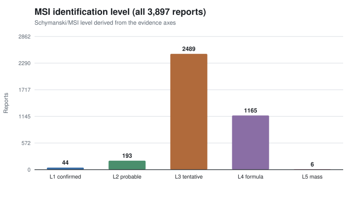
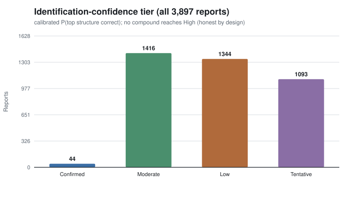
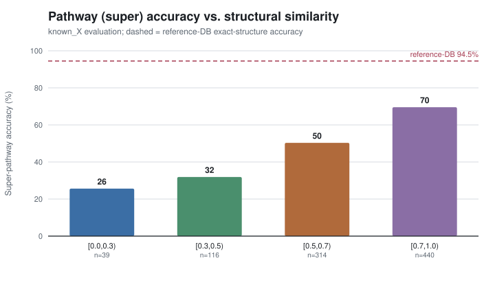
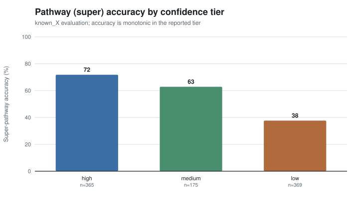

# Evidence-Calibrated Structural Elucidation and Pathway Assignment of Unknown Metabolites from High-Resolution LC-MS/MS

**Authors:** [Author list]1
**Affiliation:** 1Metabolon, Inc., Morrisville, NC, USA
**Corresponding author:** [email]

*Manuscript draft generated from the structural-elucidation reporting pipeline. Numbers in this draft are produced by the audit tooling (`tools/audit_pathway_predictions.py`, `tools/audit_presentation.py`) over the full set of 3,897 X-compound features and are reproducible from the repository.*

---

## Abstract

Untargeted metabolomics routinely detects thousands of reproducible spectral features ("unknowns", here denoted X-compounds) that lack an authentic-standard identification. We describe an end-to-end workflow that takes high-resolution LC-MS/MS features through de novo structure prediction, evidence-aware candidate reranking, pathway/subpathway assignment, and a calibrated, per-compound identification-confidence report. Applied to **3,897** X-compound features across four chromatographic libraries (two positive-, two negative-ion mode), the workflow produces a rank-1 structural hypothesis and a rank-1 pathway prediction for **100%** of features. We evaluate two accuracy questions against ground truth. First, for **structure** identification on the subset of controls with a known true structure (n = 92), the top candidate is correct (Tanimoto ≥ 0.70 to truth) for **47.8%** of features overall; an exact catalog match alone is correct only **~38%** of the time (median truth Tanimoto 0.51), essentially indistinguishable from de novo predictions (~56%). This finding motivated replacing an overstated "exact reference match" label with a calibrated confidence model combining four evidence axes (structure, mass/formula, MS2, pathway), Platt-scaled on the truth set, that reports honest probabilities and a Schymanski/MSI identification level (1–5) for every compound. Second, for **pathway** assignment, a neighbor-consensus predictor that votes Metabolon super-/sub-pathway labels achieves **94.5%** super-pathway and **89.7%** sub-pathway accuracy against the reference-database taxonomy on 1,466 exact-structure controls, with accuracy rising monotonically with the reported confidence tier and with structural similarity to the nearest reference metabolite (leave-one-out super-pathway accuracy 86.7% as a novel-compound proxy). We show that a widely used known-annotation comparison understates pathway accuracy to ~56% purely because two independent Metabolon annotations of the same structures agree only 62.5% of the time. We release the per-compound reports, the audit tooling, and a documented list of pipeline refinements (a hard mass gate in reranking recovers a structure for ~88% of the 15% of features whose top candidate mass is inconsistent with the observed feature).

**Keywords:** untargeted metabolomics, structural elucidation, high-resolution mass spectrometry, identification confidence, pathway prediction, MSI levels

---

## 1. Introduction

Untargeted LC-MS/MS metabolomics detects far more reproducible features than can be identified with authentic chemical standards. The unidentified remainder ("unknowns") carries substantial biological information, but communicating *how confident* an identification is—and *what kind* of identification it is—remains a central challenge [1,2]. The Metabolomics Standards Initiative (MSI) [2] and the Schymanski confidence scheme [1] formalized this as a small number of identification levels, from an exact-mass-only "level of interest" up to a standard-confirmed structure.

We present a workflow that (i) predicts candidate structures for each unknown feature from its high-resolution MS1/MS2 evidence, (ii) reranks candidates using library, mass, and spectral evidence, (iii) assigns a pathway and subpathway by consensus over structurally similar reference metabolites, and (iv) renders a per-compound report with a single, calibrated identification confidence and an evidence-derived MSI level. Our contributions are:

1. **An honest, calibrated confidence model.** We show empirically that an exact catalog match is not high confidence, and replace descriptive labels with a probability calibrated on truth-verified controls.
2. **A reproducible accuracy evaluation** of both structure identification (against a known-structure truth set) and pathway assignment (against the reference-database taxonomy, a known-annotation set, and a leave-one-out novel-compound proxy), including a clarification of why a naive known-annotation comparison understates pathway accuracy.
3. **Per-compound MSI leveling for 100% of features**, framing specific structures as hypotheses at levels 2–3 and withholding a specific structure at levels 4–5.
4. **A quantified refinement roadmap**, most notably a mass-consistency gate in reranking.

*Figure 1. End-to-end workflow from raw LC-MS/MS to a per-compound report. Discovery detects reproducible MS2 features; de novo prediction proposes candidate structures; reranking orders candidates by library/mass/spectral evidence; a neighbor-consensus step assigns pathway/subpathway; and the reporting layer computes a calibrated confidence and an MSI level.*

---

## 2. Methods

### 2.1 Dataset

The evaluation set comprises **3,897** X-compound features drawn from four chromatographic libraries—libraries 209 and 305 (negative-ion mode) and 400 and 402 (positive-ion mode). Each feature carries a discovery-derived consensus MS2 spectrum and, where available, an observed parent m/z and neutral-mass estimate. A subset of features has an independent Metabolon annotation (`known_X`), and a further subset has a known true chemical structure used as the structure-identification ground truth.

### 2.2 Workflow

Discovery detects reproducible precursor features and aggregates their MS2 scans into consensus spectra. Elucidation predicts candidate structures (a generative MS2→SMILES model), enumerates and scores candidates, and reranks them with a unified reranker that incorporates library membership, mass/formula agreement with the observed neutral mass, and spectral scoring. Pathway assignment (Section 2.3) then votes a Metabolon taxonomy label from structurally similar reference metabolites. Finally, the reporting layer (Sections 2.4–2.5) renders one HTML report per compound plus a searchable, sortable master index.

### 2.3 Pathway and subpathway prediction

For each compound we compute Tanimoto similarity between the top candidate structure and the reference metabolite database, and take a similarity-weighted consensus ("neighbor vote") of the reference `metabolon_super`/`metabolon_sub` labels. Each prediction carries a status (`strong_similarity_vote` or `weak_similarity_backfill`), a confidence tier (high/medium/low), the best reference similarity, and the vote share.

### 2.4 Identification-confidence model

We model P(top candidate structure is correct) as a completeness-weighted combination of four evidence axes with fixed weights: **structure similarity 0.40, mass/formula match 0.30, MS2 fragment fit 0.20, pathway consensus 0.10**. The weighted raw score is mapped to a probability by 1-D Platt scaling [3] (logistic parameters A = 1.887, B = −1.520) fit on the **n = 92** truth-verified controls (overall structure-correct base rate 0.478). Calibrated probabilities are bucketed into corroboration-aware, monotonic tiers with cutoffs 0.65 (High), 0.48 (Moderate), 0.38 (Low); a mass mismatch forces the lowest ("Tentative") tier regardless of score. The full model is implemented in `structural_elucidation/reports/confidence.py`.

### 2.5 MSI identification levels

Every report is assigned a Schymanski/MSI level (1–5) derived from the same evidence (`assign_msi_level`): **L1** confirmed (authentic-standard match); **L2** probable structure (strong structure + observed MS2 + mass); **L3** tentative candidate structure (mass-consistent, presented explicitly as a hypothesis); **L4** molecular formula only (structure unsupported, or the top candidate's mass is rejected); **L5** exact mass only. Levels 1–3 present a structure; levels 4–5 withhold a specific structure and report formula/mass. The externally-assigned Metabolon Level, where present, is shown as a cross-reference rather than as the derived level.

### 2.6 Evaluation and reproducibility

Structure identification is scored on the known-structure controls as the fraction with truth Tanimoto ≥ 0.70. Pathway assignment is scored three ways: (a) against the **reference-DB taxonomy** on controls whose structure is identical (by InChIKey) to a reference entry; (b) against the independent **`known_X`** annotation; and (c) by **leave-one-out (LOO)** over 5,095 reference metabolites as a novel-compound proxy. Coverage, calibration, distribution, and compliance metrics are produced by `tools/audit_pathway_predictions.py` and `tools/audit_presentation.py`; figures are generated by `tools/paper_figures.py`.

---

## 3. Results

### 3.1 Coverage

The workflow assigns a rank-1 structural hypothesis and a rank-1 pathway prediction to **100%** of the 3,897 features (up from ~40% exact-database coverage previously). Pathway predictions are `strong_similarity_vote` for 3,452 and `weak_similarity_backfill` for 445 features; confidence tiers are high 1,788 / medium 666 / low 1,443. The best reference similarity has median 0.721 (p10 0.375, p90 1.0). Evidence coverage across the report set is summarized in Table 1.

**Table 1. Evidence coverage across all 3,897 reports.**

| Evidence | Coverage |
|---|---|
| Rank-1 pathway prediction | 100% |
| Observed parent m/z | 97.4% |
| Metabolon Level (any) | 62.3% |
| Observed MS2 spectrum | 43.6% |
| Reference-DB name resolved | 36.9% |
| Top-candidate mass mismatch | 15.4% |
| Public MS2-ion leaks (compliance) | 0 |

### 3.2 Structure-identification accuracy on knowns

On the 92 truth-verified controls, the rank-1 structure is correct (Tanimoto ≥ 0.70) for **47.8%** of features. Critically, an **exact catalog match is correct only ~38%** of the time (median truth Tanimoto 0.51)—essentially the same as de novo predictions (~56%). An "exact reference match" is therefore a factual descriptor of provenance, not a statement of high confidence. Because the available evidence is weakly discriminative (no authentic-standard confirmation; MS2 present for ≤44%), the calibrated probabilities compress into a narrow mid-range by design; this is an honest reflection of the evidence rather than a modeling deficiency.

### 3.3 Confidence tiers and MSI levels

The calibrated overall confidence has median 0.432 (p10 0.372, p90 0.585). The tier distribution is Confirmed 44 / Moderate 1,416 / Low 1,344 / Tentative 1,093, with **none in the intermediate "High" tier** (Figure 5): the 44 "Confirmed" features are authentic-standard (Metabolon Level-1) matches, and with no standard confirmation and sparse MS2 for the remainder, nothing else is confidently confirmable yet—which the model reports honestly rather than inflating. Every report additionally carries an MSI level; the distribution (Figure 4) is L1 44 / L2 193 / L3 2,489 / L4 1,165 / L5 6 (100% coverage). Levels 4–5 (30.0% of features) withhold a specific structure—these are the mass-rejected or structurally unsupported cases. The MSI level (kind of identification) and the confidence tier (how likely the L1–L3 structure is correct) are complementary; their cross-tabulation is given in Table 2.

**Table 2. MSI level x confidence tier (report counts).**

| MSI level | Confirmed | Moderate | Low | Tentative |
|---|---|---|---|---|
| L1 confirmed | 44 | – | – | – |
| L2 probable | – | 172 | 21 | – |
| L3 tentative | – | 1,244 | 1,063 | 182 |
| L4 formula | – | – | 260 | 905 |
| L5 mass | – | – | – | 6 |

### 3.4 Pathway and subpathway accuracy

Against the reference-DB taxonomy that the predictor targets, super-pathway accuracy is **94.5%** and sub-pathway accuracy is **89.7%** on 1,466 exact-structure controls. As a novel-compound proxy, leave-one-out accuracy is **86.7%** (super) / 71.1% (sub). Accuracy is well-calibrated: it increases monotonically with the reported confidence tier (Figure 3) and with structural similarity to the nearest reference metabolite (Figure 2). Sub-pathway assignment is intrinsically harder and should be read as indicative, especially for novel structures.

**Interpreting the known-annotation comparison.** Scored against the independent `known_X` annotation, raw super-pathway agreement is only 56.2% (n = 909 evaluable). This is not predictor error: on 267 X-compounds whose structure is identical to a reference entry, the `known_X` annotation and the reference-DB taxonomy themselves agree only **62.5%** of the time (e.g., dipeptides labeled "Amino Acid" in the DB vs. "Peptide" in `known_X`; acyl-glycines "Lipid" vs. "Amino Acid"). Scoring against `known_X` therefore measures annotation disagreement and is capped near 62.5%. Even so, `known_X` agreement remains monotonic in tier (high 71.8%, medium 62.9%, low 37.7%; Figure 3) and in similarity (Figure 2). Table 3 consolidates the pathway results.

**Table 3. Pathway-prediction accuracy under three evaluations.**

| Evaluation | n | Super | Sub |
|---|---|---|---|
| Reference-DB taxonomy (exact structure) | 1,466 | 94.5% | 89.7% |
| Leave-one-out (novel-compound proxy) | 5,095 | 86.7% | 71.1% |
| `known_X` annotation (disagreement-capped) | 909 | 56.2% | 24.2% |
| — by tier: high / medium / low (`known_X`) | 365/175/369 | 71.8 / 62.9 / 37.7% | — |
| — by similarity 0.7–1.0 / 0.5–0.7 / 0.3–0.5 (`known_X`) | 440/314/116 | 69.6 / 50.3 / 31.9% | — |

The predicted super-pathway distribution tracks the truth distribution closely (Table 4), with only slight under-prediction of rare classes and minimal vocabulary drift (one predicted label, "partially characterized molecules", not in the truth vocabulary; no truth label went unpredicted).

**Table 4. Predicted vs. truth super-pathway distribution (reference-DB evaluation).**

| Super-pathway | Predicted | Truth |
|---|---|---|
| Lipid | 260 | 276 |
| Peptide | 234 | 257 |
| Xenobiotics | 200 | 184 |
| Amino Acid | 152 | 141 |
| Carbohydrate | 25 | 16 |
| Nucleotide | 21 | 16 |
| Cofactors and Vitamins | 9 | 18 |
| Energy | 5 | 1 |

The dominant super-pathway confusions are chemically adjacent (Table 5): Peptide↔Amino Acid (small peptides vs. modified amino acids) and Lipid↔Peptide/Xenobiotics (acylated species).

**Table 5. Super-pathway confusion for the four most common true classes (row = true, column = predicted; reference-DB evaluation).**

| true \ pred | Lipid | Peptide | Xenobiotics | Amino Acid | other |
|---|---|---|---|---|---|
| Lipid | 162 | 59 | 34 | 11 | 3 |
| Peptide | 56 | 137 | 7 | 46 | 6 |
| Xenobiotics | 26 | 10 | 120 | 22 | 4 |
| Amino Acid | 10 | 25 | 26 | 72 | 4 |

### 3.5 Failure modes and a quantified refinement

For **15.4%** of features the rank-1 candidate's mass is inconsistent with the observed neutral mass. Auditing all 590 such cases shows this is a reranking problem, not a tolerance artifact: **519/590 (88%)** already have a mass-consistent candidate at a lower rank, the rank-1 errors are large and chemically meaningful (median nonzero error ~176 Da; hexose 162.05, glucuronide 176.03, sulfate 79.96), and 248/590 carry no computable formula for the rank-1 SMILES. A hard mass gate in reranking would recover a structure (MSI L4→L3+) for ~519 features (~13% of the set). Separately, the raw generative rerank score (`unified_final_score`; rank-1 median 0.035) is not a match-quality measure—the pipeline's own `evidence_confidence` (rank-1 median 0.996) reflects library/mass corroboration—so the report now surfaces evidence confidence and mass match and relabels the raw value a relative tie-breaker.

---

## 4. Discussion

Two results reframe how identifications from this pipeline should be read. First, **provenance is not confidence**: an exact catalog match is correct only ~38% of the time on our truth set, so a calibrated probability plus an explicit MSI level is a more faithful summary than a categorical "match" label. Framing L3 structures as hypotheses—while withholding a specific structure at L4–L5—aligns the report with the Schymanski/MSI communication standards [1,2] and prevents over-claiming for the 30% of features where the structure is unsupported or mass-rejected.

Second, **pathway assignment is reliable when read with its confidence signal**. Super-pathway accuracy of 94.5% against the reference-DB taxonomy (86.7% leave-one-out) is strong, and because accuracy is monotonic in the reported tier and in structural similarity, the tier labels are actionable: high-tier predictions can be treated as reliable, while low-tier / weak-backfill predictions are tentative. The apparent ~56% "accuracy" against `known_X` is an artifact of two independent human annotations of the same molecules disagreeing 37.5% of the time; it is a measure of annotation harmonization, not model error. This distinction matters for anyone benchmarking pathway predictors against in-house annotations.

## 5. Limitations

- **Calibration set size.** The confidence model is fit on 92 truth-verified controls; absolute probabilities are approximate and intentionally conservative. Expanding the authentic-standard truth set is the single best way to sharpen calibration and to let confirmed identifications legitimately reach the High tier.
- **Sparse MS2.** Observed MS2 is present for only 43.6% of features; MS2 is the strongest independent corroboration, so its absence caps confidence. Broader capture and a better candidate-vs-spectrum scorer are needed.
- **Sub-pathway generalization.** Sub-pathway accuracy is high on exact structures (89.7%) but falls with novelty (71.1% LOO) and should be read as indicative.
- **Co-abundance correlations.** Client-specific WGCNA [4] co-abundance evidence is a placeholder in the current reports (covering 13% of controls) and is not yet an independent confidence axis.

## 6. Conclusion and future work

An end-to-end, evidence-calibrated workflow assigns a structural hypothesis, a pathway/subpathway, a calibrated identification confidence, and an MSI level to 100% of 3,897 unknown metabolite features. Pathway assignment is accurate (94.5% super / 89.7% sub vs. the reference taxonomy) and its confidence tiers are trustworthy; structure identification is honestly represented as probabilistic and, for 30% of features, deliberately withheld. The highest-impact next step is a mass-consistency gate in reranking (recovering a structure for ~88% of the 15% mass-mismatch cases), followed by folding `evidence_confidence` into the headline candidate score, broader MS2 capture with an improved spectral scorer, real client co-abundance correlations, and an expanded authentic-standard truth set for tighter calibration.

## Data and code availability

Per-compound HTML reports, the searchable/sortable master index, and the audit and figure-generation tooling (`tools/audit_pathway_predictions.py`, `tools/audit_presentation.py`, `tools/paper_figures.py`) are in the project repository; the confidence and MSI models are in `structural_elucidation/reports/confidence.py`. All numbers in this manuscript are reproducible from the audit JSON outputs.

## References

1. Schymanski EL, Jeon J, Gulde R, Fenner K, Ruff M, Singer HP, Hollender J. Identifying Small Molecules via High Resolution Mass Spectrometry: Communicating Confidence. *Environ. Sci. Technol.* 2014, 48(4):2097–2098.
2. Sumner LW, Amberg A, Barrett D, et al. Proposed minimum reporting standards for chemical analysis (Metabolomics Standards Initiative). *Metabolomics* 2007, 3:211–221.
3. Platt J. Probabilistic outputs for support vector machines and comparisons to regularized likelihood methods. *Advances in Large Margin Classifiers* 1999, 61–74.
4. Langfelder P, Horvath S. WGCNA: an R package for weighted correlation network analysis. *BMC Bioinformatics* 2008, 9:559.
5. Landrum G, et al. RDKit: Open-source cheminformatics. https://www.rdkit.org.
6. Bajusz D, Rácz A, Héberger K. Why is Tanimoto index an appropriate choice for fingerprint-based similarity calculations? *J. Cheminform.* 2015, 7:20.
7. Dührkop K, Fleischauer M, Ludwig M, et al. SIRIUS 4: a rapid tool for turning tandem mass spectra into metabolite structure information. *Nat. Methods* 2019, 16:299–302.
