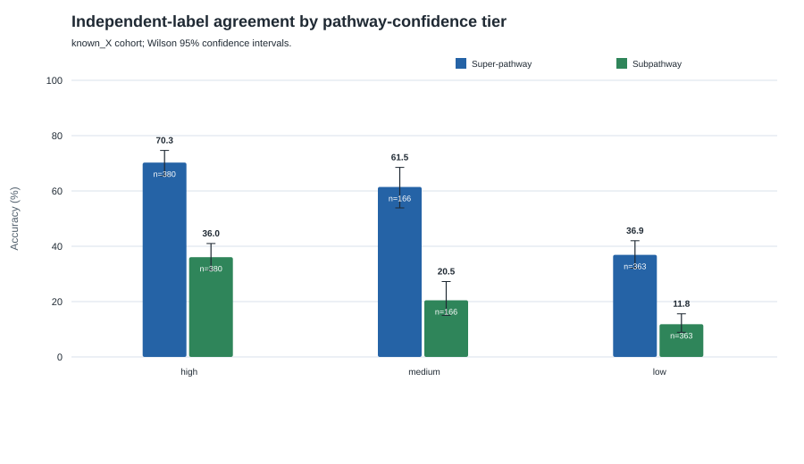
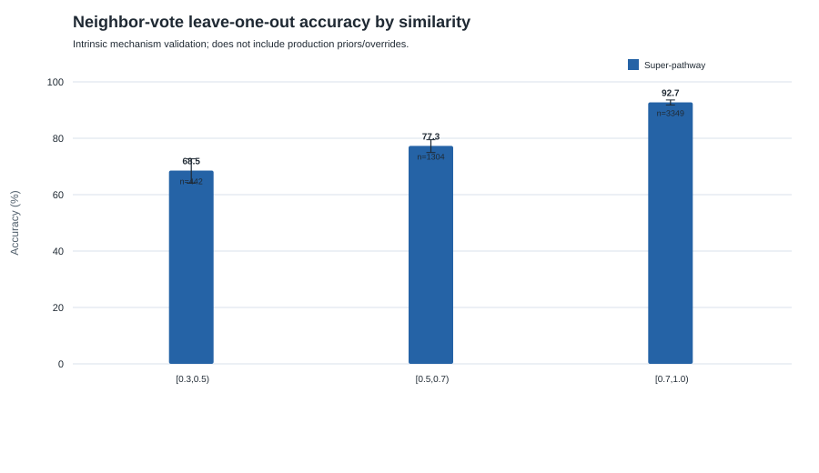
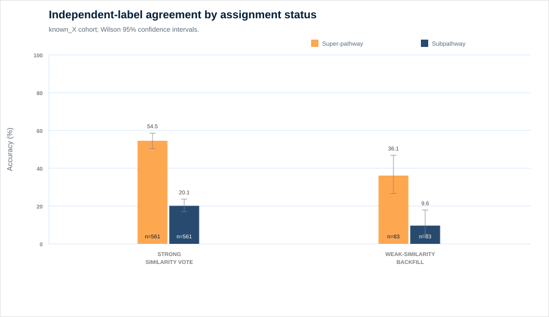
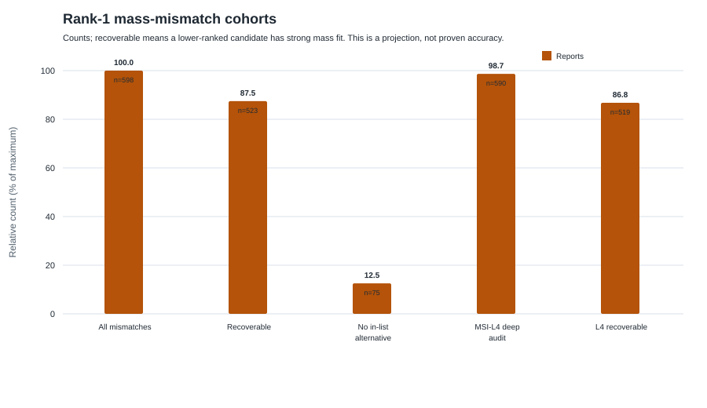
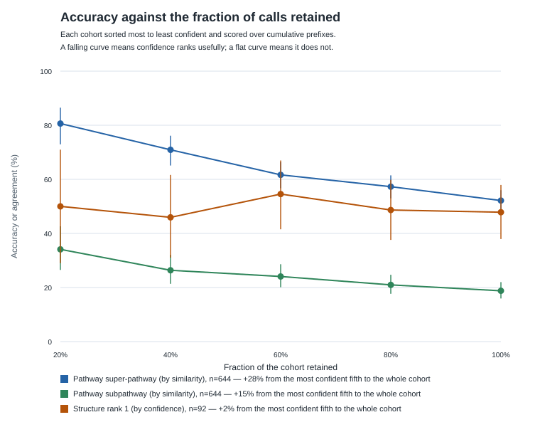

# Supplementary Information

## S1. Internal toolkit-benchmarking design (prospective)

The earlier internal study design compares MS2Query, SIRIUS, Spec2Mol, and MSNovelist with the legacy workflow using CASMI categories: adduct, elemental formula, structure class, and 2D structure. Library 1 contains 2,091 known serum/plasma metabolites spanning 9 super-pathways and 135 subpathways. Library 2 contains 120 internally confirmed NMD/X-compounds plus 500 CASMI 2022 compounds. No comparative toolkit results were available for this manuscript; the design is prospective and its counts are not pooled with the 3,897-feature deployed evaluation.

## S2. Cohorts, confidence vocabularies, and key terms

| Term | Definition | Source / status |
|---|---|---|
| Delivered set | 3,897 unique X-compounds; first library wins duplicates | report bundle |
| Structure truth set | 92 controls with nonzero `truth_tanimoto` | candidate sidecars |
| Reference-structure cohort | 1,466 rank-1 structures present in reference DB | 1,459 direct lookups |
| `known_X` cohort | 909 controls with independent super-/subpathway labels | taxonomy-discordant |
| P0 | true unknowns with `has_p0_reference=true` | authoritative P0 flags file unavailable |
| P1 | Metabolon Level 1 plus Level 2/2C | authoritative P1 truth directory unavailable |
| Pathway-confidence tier | high / medium / low neighbor-vote confidence | not structure confidence |
| Identification-confidence tier | Confirmed / High / Moderate / Low / Tentative | exploratory Platt score |
| MSI reporting level | evidence-derived L1–L5 rubric | custom; not externally validated |

The terms below name where a candidate came from. They are recorded per candidate and are reported throughout as provenance, which is a different quantity from corroboration; Methods Section 2.7 carries the full glossary.

| Term | Definition | Source / status |
|---|---|---|
| Reference library | catalogue of compounds with measured spectra and curated metadata | proprietary; controlled access |
| Retrieval (library matching) | candidates proposed by searching that catalogue | Track A of the inference stack |
| Analogue search | relaxed match returning related catalogue entries | not used as a confirmation route |
| De novo generation | candidates proposed without catalogue membership | Track B of the inference stack |
| Catalog provenance (exact source) | the candidate was proposed by matching a catalogued structure | 42 of the 92 truth controls |
| Authentic standard | reference compound run under the same conditions | the only basis for L1 here |

**Table S1. Evidence coverage across all delivered reports.**

| Evidence | n / 3,897 (%) |
|---|---:|
| Biochemical taxonomy assignment | 3,897 (100.0%) |
| Observed parent m/z | 3,796 (97.4%) |
| Metabolon Level (any) | 2,426 (62.3%) |
| Observed MS2 spectrum | 1,700 (43.6%) |
| Reference-database name resolved | 1,437 (36.9%) |
| Top-candidate mass mismatch | 598 (15.3%) |
| Public MS2-ion leaks | 0 (0.0%) |

**Table S2. MSI-style reporting level × identification-confidence tier (counts).**

| MSI level | Confirmed | High | Moderate | Low | Tentative |
|---|---:|---:|---:|---:|---:|
| L1 | 44 | 0 | 0 | 0 | 0 |
| L2 | 0 | 0 | 172 | 21 | 0 |
| L3 | 0 | 0 | 1244 | 1063 | 182 |
| L4 | 0 | 0 | 0 | 260 | 905 |
| L5 | 0 | 0 | 0 | 0 | 6 |

## S3. Structural recovery and threshold sensitivity

**Table S3. Cumulative structural recovery on n=92 truth controls (Wilson 95% confidence intervals).**

| Truth threshold | Rank 1 | Top 3 | Top 10 |
|---|---:|---:|---:|
| Tanimoto ≥ 0.50 | 59.8% (49.6–69.2%) | 72.8% (63.0–80.9%) | 77.2% (67.6–84.6%) |
| Tanimoto ≥ 0.70 | 47.8% (37.9–57.9%) | 64.1% (53.9–73.2%) | 73.9% (64.1–81.8%) |
| Tanimoto ≥ 0.85 | 40.2% (30.8–50.4%) | 56.5% (46.3–66.2%) | 65.2% (55.0–74.2%) |
| Exact 2D | 38.0% (28.8–48.2%) | 55.4% (45.3–65.2%) | 64.1% (53.9–73.2%) |

**Table S4. Rank-1 recovery by provenance.**

| Source | n | Accuracy (95% CI) | Median truth Tanimoto (bootstrap 95% CI) |
|---|---:|---:|---:|
| exact | 42 | 38.1% (25.0–53.2%) | 0.506 (0.251–0.707) |
| predicted | 50 | 56.0% (42.3–68.8%) | 0.811 (0.565–1.000) |

### S3.1 Cross-validated calibration

Full model leave-one-out Brier score: **0.2546**; calibration slope 0.056, intercept -0.082. Without the pathway axis, Brier score is **0.2528**. These results indicate weak discrimination/calibration and motivate treating the score as exploratory.

## S4. Pathway evaluation details

**Table S5. Independent-label agreement by assignment status.**

| Status | Super-pathway (95% CI) | Subpathway (95% CI) |
|---|---:|---:|
| exact_reference_match | 63.0% (57.1–68.6%) | 35.1% (29.6–41.0%) |
| strong_similarity_vote | 54.5% (50.4–58.6%) | 20.1% (17.0–23.7%) |
| weak_similarity_backfill | 36.1% (26.6–46.9%) | 9.6% (5.0–17.9%) |

Leave-one-out uses k=10, similarity floor=0.3, and similarity exponent=2.0. It evaluates the neighbor-vote mechanism only, not the complete production predictor.

**Annotation ceiling.** On the 267 controls whose structure is identical to a reference entry, the assignment is a copy of the reference label, so its agreement with `known_X` is the highest any predictor targeting the reference taxonomy could score: 62.5% (56.6–68.1%) at super-pathway and 34.8% (29.4–40.7%) at subpathway. Every `known_X`-scored figure in this document should be read against those bounds rather than against 100%.

**Table S6. Predicted vs independent `known_X` super-pathway distribution (n=909).**

| Super-pathway | Predicted | Independent label |
|---|---:|---:|
| Lipid | 257 | 276 |
| Peptide | 231 | 257 |
| Xenobiotics | 204 | 184 |
| Amino Acid | 153 | 141 |
| Cofactors and Vitamins | 9 | 18 |
| Carbohydrate | 26 | 16 |
| Nucleotide | 21 | 16 |
| Energy | 5 | 1 |
| Partially Characterized Molecules | 3 | 0 |

**Table S7. Independent-label super-pathway confusion for the four most common classes.**

| Independent label | Lipid | Peptide | Xenobiotics | Amino Acid | Other |
|---|---:|---:|---:|---:|---:|
| Lipid | 159 | 59 | 35 | 11 | 5 |
| Peptide | 56 | 135 | 8 | 47 | 6 |
| Xenobiotics | 26 | 10 | 119 | 23 | 4 |
| Amino Acid | 10 | 24 | 28 | 71 | 4 |

## S5. Mass-mismatch audit

There are **598** rank-1 mass mismatches among 3897 reports. **590** are in the MSI-L4 deep-audit subset. A lower-ranked mass-consistent candidate exists for **523/598** overall and **519/590** in the L4 subset. These are projected reranking opportunities, not demonstrated correct structures.

## S6. Per-library delivered cohort

| Library | Ion mode | n | Percentage |
|---|---|---:|---:|
| 209 | negative | 2,389 | 61.3% |
| 305 | negative | 202 | 5.2% |
| 400 | positive | 875 | 22.5% |
| 402 | positive | 431 | 11.1% |

## S7. Required provenance before submission

- Complete author list, corresponding-author email, CRediT roles, funding, and conflict disclosures.
- Source-study matrix/species metadata and ethics/consent/IRB determination.
- Spec2Mol encoder/decoder checkpoint hashes, training snapshot, random seeds, software/CUDA versions, and EC2 hardware.
- Production neighbor-builder parameters and override rules.
- Authoritative P0 flags and P1 truth files for cohort-specific rank-1/top-10 results.
- Immutable repository release/DOI and controlled-access data instructions.

Full-set identification-confidence median: 0.4322; MSI coverage: 100.0%.

## S8. Taxonomy harmonization and selective prediction

Corrections are applied identically to the predictor and to the annotation ceiling. The final column is the comparable one: a correction that lifts both has exposed a measurement artefact rather than a better predictor.

**Table S8. Independent-label agreement under vocabulary corrections.**

| Scenario | Inferred assignments | Annotation ceiling | Share of ceiling |
|---|---:|---:|---:|
| Super-pathway, as scored | 52.2% (48.3–56.0%) | 62.5% (56.6–68.1%) | 83.4% |
| Super-pathway, amino acid = peptide | 59.5% (55.6–63.2%) | 71.5% (65.8–76.6%) | 83.1% |
| Subpathway, as scored | 18.8% (16.0–22.0%) | 34.8% (29.4–40.7%) | 53.9% |
| Subpathway, scoreable labels only | 23.6% (20.2–27.5%) | 42.7% (36.3–49.3%) | 55.4% |

181 of the independent subpathway labels are internal review notes or explicit non-answers rather than taxonomy terms, against which no prediction can score; those rows are the difference between the two subpathway scenarios.

Merging every commonly confused class would reach 93.3% (91.1–95.0%) on the inferred assignments. That collapse merges four of the eight super-pathways, including an origin-based class that overlaps every structural one, so it is reported as an upper bound and not adopted.

Selective prediction asks whether confidence orders calls at all. Each cohort is sorted from most to least confident and scored over cumulative prefixes. Pathway assignments ranked by best-reference similarity gain 28 percentage points of super-pathway agreement between the whole cohort and its most confident fifth, whereas structural calls ranked by identification confidence gain 2 and do not order features at all.

## S9. Agreement by chromatographic library

Inferred assignments only, since direct lookups copy a reference label rather than predict one. This tests whether the pooled figures average over dissimilar populations.

**Table S9. Independent-label agreement by library.**

| Library | n | Super-pathway (95% CI) | Subpathway (95% CI) |
|---|---:|---:|---:|
| 209 | 464 | 53.2% (48.7–57.7%) | 17.7% (14.5–21.4%) |
| 400 | 80 | 43.8% (33.4–54.7%) | 22.5% (14.7–32.8%) |
| 402 | 84 | 50.0% (39.5–60.5%) | 17.9% (11.1–27.4%) |

Every interval overlaps at both levels, so agreement does not vary detectably by library and the pooled figures are not an average over dissimilar populations. Excluded as underpowered: 305 (n=13), unlabelled (n=3).

Structural recovery cannot be stratified the same way. The truth-verified cohort splits across libraries as 209 n=52, 305 n=6, 400 n=26, 402 n=2, unlabelled n=6, so a per-library recovery rate would be noise. That imbalance is the evidence for the cohort-selection caveat in Limitations.

## S10. Evidence-score parameters and their bands

What each parameter measures, what it is worth, and where the boundaries fall that separate a strong value from one the report treats as a caution. Exported from the constants the scoring code applies, so this table cannot describe a model other than the one that ran.

The bands say how a measurement is read, not how often that reading is right. The aggregate score is Platt-scaled in-sample and is not externally calibrated, so no band below should be read as a probability of correctness.

The last column is the sentence a report carries for a value in that band. A name in braces is filled in per feature with the measured value.

**Table S10. Evidence-score parameters, weights, and value bands.** Weights total 1.05 across the 5 scored axes; a parameter marked unscored contributes nothing to the score and is shown for context.

| Parameter | Weight | Strength | Low end | High end | Units | What the report says |
|---|---:|---|---:|---:|---|---|
| Structure similarity | 0.40 | Strong | 0.85 | 1.00 | Tanimoto similarity | Top structure is very close to a cataloged metabolite |
| Structure similarity | 0.40 | Acceptable | 0.45 | 0.85 | Tanimoto similarity | Top structure is moderately similar to the nearest cataloged metabolite |
| Structure similarity | 0.40 | Borderline | 0.00 | 0.45 | Tanimoto similarity | Top structure is distant from any cataloged metabolite (de novo) |
| Mass / formula match | 0.30 | Strong | 0.000 Da (0.0 ppm) | 0.001 Da (3.3 ppm) | absolute neutral-mass error | The mass of the proposed structure matches the observed mass, which is a strong match for this parameter |
| Mass / formula match | 0.30 | Acceptable | 0.001 Da (3.3 ppm) | 0.0025 Da (8.3 ppm) | absolute neutral-mass error | Partial mass agreement |
| Mass / formula match | 0.30 | Borderline | 0.0025 Da (8.3 ppm) | no limit | absolute neutral-mass error | Candidate mass does NOT match the target neutral mass |
| MS2 fragment fit | 0.20 | Strong | 0.50 | 1.00 | spectral fit | Observed MS2 spectrum explained by candidate (fit {fit}) |
| MS2 fragment fit | 0.20 | Acceptable | 0.30 | 0.50 | spectral fit | Observed MS2 spectrum explained by candidate (fit {fit}) |
| MS2 fragment fit | 0.20 | Borderline | 0.00 | 0.30 | spectral fit | Observed MS2 spectrum poorly explained by candidate (fit {fit}) |
| Pathway consensus | 0.10 | Strong | 0.90 | 1.00 | neighbor vote share | Neighbor pathway consensus {share} |
| Pathway consensus | 0.10 | Acceptable | 0.60 | 0.90 | neighbor vote share | Neighbor pathway consensus {share} |
| Pathway consensus | 0.10 | Borderline | 0.00 | 0.60 | neighbor vote share | Neighbor pathway consensus {share} |
| Retention-index fit | 0.05 | Strong | 0.0 sigma | 1.0 sigma | residual sigma | Retention is consistent with the candidate ({sigma} sigma) |
| Retention-index fit | 0.05 | Acceptable | 1.0 sigma | 3.0 sigma | residual sigma | Retention is a loose fit ({sigma} sigma from the predicted index) |
| Retention-index fit | 0.05 | Borderline | 3.0 sigma | no limit | residual sigma | Candidate could not have eluted here ({sigma} sigma from its predicted index) |
| Library neighbors | — | Not scored | 0 | no limit | count of library standards at Tanimoto >= 0.50 | This metabolite is similar to {count} Metabolon library standards, enabling a higher confidence structural candidate |

Where a band changes what the report may claim:

- **Structure similarity, acceptable.** At or above 0.70 the candidate can reach MSI Level 2 given MS2 and mass support; at or above 0.45 it can reach Level 3.
- **Structure similarity, borderline.** Below this the structure cannot support MSI Level 3, so the report withholds a structure and gives formula or mass only.
- **Mass / formula match, strong.** Sub-score 1.00. The plateau makes this the only way to clear the 0.90 strong-mass bar: leaving it drops the score straight to 0.80, so nothing scores between 0.80 and 1.00.
- **Mass / formula match, acceptable.** Sub-score 0.50 to 0.80. Too low for the strong-mass bar, so it cannot reach MSI Level 2.
- **Mass / formula match, borderline.** Sub-score below 0.50, which demotes the report to Tentative whatever the other axes say, and caps it at MSI Level 4 or below.
- **MS2 fragment fit, strong.** Meets the higher bar an exact catalog hit must clear for MSI Level 2, which exists because a catalog match supplies no spectral evidence of its own.
- **MS2 fragment fit, acceptable.** Enough for MSI Level 2 for a de novo candidate, not for one taken from the catalog.
- **MS2 fragment fit, borderline.** A spectrum exists and the candidate does not account for it, which is evidence against the candidate rather than missing evidence.
- **Pathway consensus, borderline.** The pathway is still reported, with the split vote behind it shown, because every feature receives pathway context whether or not a structure is shown.
- **Retention-index fit, borderline.** Demotes the report to Tentative on its own and blocks MSI Levels 2 and 3, on the reasoning that a correct structure does not elute this far from its predicted index.
- **Library neighbors, not scored.** Informational. The similarity of the single nearest standard is what the structure axis scores; the count is not scored anywhere.

Two mismatches between this table and earlier drafts of it are worth stating plainly, because both were written down before the code was checked. Mass agreement is scored on an absolute mass error, not on a fixed parts-per-million window, so a single ppm figure holds only at one mass; the equivalents above are quoted at 300 Da and tighten as the compound gets heavier. And the count of similar library standards is context on the report card rather than an axis: no count acts as a cutoff, and changing it moves no score.

**The mass row describes the implemented function, not the delivered numbers.** Measured against the delivered bundle, 22,204 of 31,645 candidate scores follow `1 - error_da` and only 56 follow the windows quoted above. Under the rule the reports were actually scored with, the strong-mass cutoff admits an error near 0.1 Da, which is hundreds of parts per million rather than the few implied here. Which rule is authoritative is unresolved: either the scorer in the inference package is not what produced the delivered set, or the delivered set predates it. Until that is settled the mass bands above should be read as a description of the code, and `docs/paper/data/thresholds/audit_mass_policy.json` as a description of what shipped.
