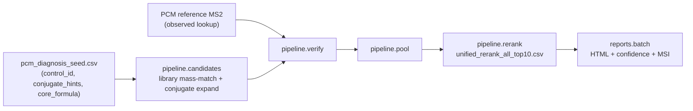

# PCM Structure-Prediction Handoff (run on EC2)

Self-contained instructions for the next agent to predict structures for the
**99 named reference-library metabolites** whose Metabolon super-pathway is
**"Partially Characterized Molecules" (PCM)**, by running this repo's existing
elucidation pipeline on the EC2 box (`ec2-user@10.12.5.28`) where the full library,
spectra, and compute live. Assume no prior context.

> **Status update (2026-07-08).** The one previously-open external input - the PCM
> reference MS2 spectra, their per-entry lib/ion mode, and their format - is now
> **RESOLVED**, and the derived inputs are **built and committed on this branch**
> (see "Artifacts already prepared"). The two missing conjugate reactions
> (glutamine, N-acetylglucosamine) are **added and validated**. The EC2 run is now
> turnkey: assemble is done locally; EC2 just runs candidates -> verify -> pool ->
> rerank -> reports. Details inline below.

## Goal

For each PCM entry (named but structurally unresolved), produce a ranked set of
candidate structures + a calibrated identification confidence + an MSI level,
delivered as the standard per-compound HTML reports. Predictions are **hypotheses**
(expected mostly MSI Level 3): the class + molecular formula + conjugate are known;
the specific isomer/regiochemistry generally is not.

## Why these are tractable (key insight)

They are not blind unknowns. Profiling the reference DB
(`metabolon_super = 'Partially Characterized Molecules'`) shows each entry encodes
its partial characterization in the name, and all are in the global library with
reference MS2 spectra - **confirmed: 106 (chemical x lib) scopes for the 99
chemicals, 100% with reference MS2** (see `docs/pcm/pcm_entry_lib_ion_mode.csv`):

- 99 entries; only 7 have any SMILES (skip those - already resolved).
- Name patterns parsed by `tools/extract_pcm_tasks.py`:
  - **conjugates (76):** glucuronide 46, glutamine 11, glycine 10, carnitine 5,
    N-acetylglucosamine 2, sulfate 2 - e.g. `"glucuronide of C12H22O4 (3)*"`,
    `"glycine conjugate of C10H12O2*"`.
  - **non-conjugate / formula placeholder (23):** a core formula but no conjugate.
  - **91/99 carry an explicit core (aglycone) molecular formula.**

So structure prediction reduces to: enumerate aglycone cores of the core formula
(library mass-match + de novo), attach the named conjugate, and rank by the
reference MS2 - exactly what `structural_elucidation/pipeline/candidates.py`
(library-anchored + conjugate expansion) already does.

## Pipeline (reuse the existing stages)



This mirrors `run_inference.sh` (per lib: candidates -> verify -> pool -> rerank),
then the report layer (`python -m structural_elucidation.reports.batch`).

## Where the PCM reference spectra live (RESOLVED)

The PCM reference MS2 does **not** need to be located as raw files on EC2 - it is
recovered from the MLIMS CHRO-LIB tables, exactly as the verifier bins observed MS2:

- **Bridge (chemical_id -> comp_id/lib_id):** `mlims_tables.pkl['chro_lib_entry']`
  maps each PCM `chemical_id` (global Metabolon id, `1000xxxxx`) to the CHRO-LIB
  `comp_id` + `lib_id` (+ `chro_lib_entry_id`, RT/RI, status). All 99 map.
- **Spectra (raw peaks):** `mlims_tables.pkl['chro_lib_masses']` holds the reference
  fragment peaks per `(comp_id, lib_id, chro_lib_entry_id)` as `mass` (fragment m/z)
  + `mass_ratio` (relative intensity) + `data_stream` (polarity, e.g. `-i`).
- **Ion mode from lib_id:** `209`/`305` -> **negative**, `400`/`402` -> **positive**
  (the standard lib->polarity map already used across this repo).
- **Local copy exists** at `~/dev/modelfiles/mlims_tables.pkl` (this box), so the
  inputs below were built locally; on EC2 use the same pickle (or the committed CSVs).

Binning is done with the verifier's own helpers (`structural_elucidation.nce.evidence`:
`neutral_mass_from_precursor`, `neutral_ion_mass`, `ion_and_loss_bins`, `mass_bin`),
so the observed bins are byte-for-byte what `pipeline.verify` expects. Verified:
computed neutral losses match the library's own peak annotations (e.g. a peak labeled
`M-128.0807` computes to loss 128.0812; `M-46.0050` -> 46.0055).

## Artifacts already prepared in this branch

Extraction / task list:
- `tools/extract_pcm_tasks.py` - extracts + parses the 99 PCM entries from the
  metabolite DB (stdlib, read-only). Re-run it on EC2 against the full
  `vendor/metabolite_synonyms.sqlite`. `KNOWN_REACTIONS` now includes glutamine +
  n-acetylglucosamine (so they no longer flag `NO_ADD_REACTION`).
- `docs/pcm/pcm_tasks.csv` - the parsed 99 (chemical_id, name, conjugate,
  conjugate_hint, reaction_available, core_formula, core_monoisotopic_mass,
  isomer_index, has_existing_smiles).
- `docs/pcm/pcm_diagnosis_seed.csv` - the 92 unresolved entries in the
  `control_id / primary_stage / conjugate_hints / core_formula` shape that
  `pipeline.candidates` consumes.

PCM MS2 + feature inputs (NEW - built by `tools/build_pcm_ms2_inputs.py`):
- `docs/pcm/pcm_entry_lib_ion_mode.csv` - **per-entry lib/ion-mode table** (106 rows;
  chemical_id, canonical_name, comp_id, lib_id, ion_mode, rt/ri, parent_mz,
  neutral_mass, n_ref_peaks, n_ion_bins, n_loss_bins, has_ms2, targeted,
  conjugate_hint). 7 chemicals appear in 2 libs.
- `data/observed_ms2_lookups/pcm_lib{209,305}_negative_observed_ms2_lookup.csv` and
  `pcm_lib{400,402}_positive_observed_ms2_lookup.csv` - **observed MS2 lookups** in
  the exact `data/observed_ms2_lookups/lib{lib}_{ion}_observed_ms2_lookup.csv` schema
  (`control_id, lib_id, ion_mode, parent_mz, neutral_mass, observed_ion_bins_json,
  observed_loss_bins_json, ms2_pairs_json, ...`). Rows: 91 / 1 / 5 / 2 = 99 targeted.
- `data/feature_rows/pcm_lib{L}_{ion}_feature_rows.csv` and
  `..._neutral_mass_hypotheses.csv` - feature rows + neutral-mass hypotheses
  (precursor m/z, adduct = `[M-H]-`/`[M+H]+`, **full-molecule** neutral mass).
- `docs/pcm/pcm_diagnosis_lib{209,305}_negative.csv`,
  `pcm_diagnosis_lib{400,402}_positive.csv` - per-lib diagnosis CSVs (seed filtered to
  each lib/ion scope, with `observed_neutral_mass` + `core_monoisotopic_mass` columns).
- `tools/build_pcm_ms2_inputs.py` - the builder; re-run on EC2 to regenerate all of
  the above from `mlims_tables.pkl` (`--mlims-pkl`, `--pcm-dir docs/pcm`,
  `--out-* ...`). Idempotent, read-only against the pickle.

## Key decisions / constraints

- **Reuse, do not rebuild.** Feed PCM through `pipeline.candidates` (it already does
  library mass-match + `CONJUGATE_REACTIONS`/`apply_reaction` conjugate expansion),
  then `verify`/`pool`/`rerank`, then `reports.batch`.
- **Two conjugate reactions were missing - now ADDED + validated.**
  `structural_elucidation/chemistry/conjugates.py::CONJUGATE_REACTIONS` covered
  glucuronide, sulfate, glycine, carnitine, taurine but NOT **glutamine** (11) or
  **N-acetylglucosamine** (2). Added to
  `structural_elucidation/nce/evidence.py::TARGETED_REACTION_SMARTS`:
  `carboxyl_glutamine_amide` (+128.05858), `glcnac_hydroxyl_conjugation` /
  `glcnac_amine_conjugation` (+203.07937), and wired
  `"glutamine"`/`"n-acetylglucosamine"` into `CONJUGATE_REACTIONS`
  (glutamine also reuses the pre-existing `amine_glutamine_like_conjugation`).
  **Validated against real PCM library masses:** the glutamine library entry
  `100020257` neutral mass = core + 128.05858 exactly, and the NAG entry `100020003`
  = core + 203.07937 exactly.
- **Mass-match target = full-molecule neutral mass.** The emitted
  `neutral_mass_hypotheses` carry the **full** observed neutral mass (core +
  conjugate), matching the established X-compound convention and what
  `verify`/`rerank` score against. `pipeline.candidates` mass-matches library
  structures to this target and then applies the conjugate reactions to each hit.
  Note the design nuance below (core-vs-full) if you want the core->conjugate
  enumeration to score well.
- **Hard mass gate applies for free.** The full molecular formula is known
  (core + conjugate), so require candidates to match it - this is exactly handoff
  item 2 in `docs/pipeline_refinement_handoff.md`; the reference prototype is
  `tools/prototype_mass_gate_rerank.py`.
- **Frame as hypotheses.** Cap at MSI Level 3 and order the `(n)` isomers by RT;
  do not claim a single regioisomer. Keep the Metabolon partial name as the anchor.
- **Enhanced reports are already available.** The calibrated confidence, MSI
  badges, candidate-widget evidence surfacing, and mass-alt callout (PR #2) are
  merged into `main`, so this branch includes them - no extra merge needed.

## Ordered steps (on EC2)

1. **Environment.** `cd` to the elucidation workspace (the box where the major runs
   were done). Activate the repo venv (`run_inference.sh` auto-uses `.venv`); ensure
   `rdkit` + `pandas` are installed. Fetch assets if needed (`fetch_assets.sh` pulls
   `vendor/metabolite_synonyms.sqlite`).
2. **(Already done - re-run only to refresh) PCM task list + MS2/feature inputs.**
   All inputs for steps below are committed on this branch. To regenerate against the
   full DB / library on EC2:
   `python3 tools/extract_pcm_tasks.py --out-dir docs/pcm` (confirm ~99 entries;
   glutamine/NAG should no longer show `NO_ADD_REACTION`), then
   `python3 tools/build_pcm_ms2_inputs.py --mlims-pkl <path>/mlims_tables.pkl
   --pcm-dir docs/pcm` to rebuild the per-lib observed lookups, feature rows,
   neutral-mass hypotheses, per-lib diagnosis CSVs, and the lib/ion-mode table.
   If the committed CSVs are acceptable as-is, skip straight to step 3.
3. **(Already done) glutamine + N-acetylglucosamine reactions** are added to
   `chemistry/conjugates.py` + `nce/evidence.py` and validated - no action needed
   unless a rebuild changes them.
4. **Run the pipeline per lib scope** (adapt `run_inference.sh`). There are 4 scopes:
   `(L,ion)` in `(209,negative)`, `(305,negative)`, `(400,positive)`, `(402,positive)`.
   Committed input paths per scope are `docs/pcm/pcm_diagnosis_lib{L}_{ion}.csv`,
   `data/feature_rows/pcm_lib{L}_{ion}_feature_rows.csv`,
   `data/feature_rows/pcm_lib{L}_{ion}_neutral_mass_hypotheses.csv`, and
   `data/observed_ms2_lookups/pcm_lib{L}_{ion}_observed_ms2_lookup.csv`:
   ```
   python -m structural_elucidation.pipeline.candidates --output-root OUT/pcm_cand_lib{L} \
       --diagnosis-csv docs/pcm/pcm_diagnosis_lib{L}_{ion}.csv \
       --feature-rows data/feature_rows/pcm_lib{L}_{ion}_feature_rows.csv \
       --neutral-mass-hypotheses data/feature_rows/pcm_lib{L}_{ion}_neutral_mass_hypotheses.csv \
       --lib-id {L} --ion-mode {ion} --controls <ids>
   python -m structural_elucidation.pipeline.verify  --output-root OUT/pcm_ver_lib{L} \
       --observed-lookup data/observed_ms2_lookups/pcm_lib{L}_{ion}_observed_ms2_lookup.csv \
       --input-candidate-metrics OUT/pcm_cand_lib{L}/candidate_metrics_all.csv \
       --lib-id {L} --ion-mode {ion} --include-all-x
   python -m structural_elucidation.pipeline.pool    --output-root OUT/pcm_pool_lib{L} \
       --scored-candidates OUT/pcm_ver_lib{L}/scored_candidates.csv --lib-id {L} --ion-mode {ion}
   python -m structural_elucidation.pipeline.rerank  --output-root OUT/rerank_pcm_lib{L} \
       --unified-pool OUT/pcm_pool_lib{L}/unified_candidates_per_control.csv --lib-id {L} --ion-mode {ion}
   ```
   (Verify exact CLI flag names against each stage's `argparse`; they mirror
   `run_inference.sh`.)
5. **Generate reports:**
   `python -m structural_elucidation.reports.batch --predictions OUT/rerank_pcm_lib*/unified_rerank_all_top10.csv --observed-lookup-dir data/observed_ms2_lookups --out-dir output/pcm_reports --jobs 8`
6. **(Optional) enhanced confidence/MSI** (available on this branch): run
   `tools/enrich_report_evidence.py` -> `tools/patch_report_confidence.py` ->
   `tools/patch_candidate_scores.py` -> `tools/rebuild_master_index.py` over
   `output/pcm_reports`.

## Expected outputs

- `OUT/rerank_pcm_lib*/unified_rerank_all_top10.csv` - ranked candidate structures
  per PCM control (same schema as the X-compound rerank).
- `output/pcm_reports/<chemical_id>/index.html` + master `index.html` - per-compound
  reports with the predicted structure(s), confidence, and MSI level.

## Verification

- **Coverage:** a rank-1 candidate for all targeted control rows - 99 rows =
  92 unresolved chemicals (7 appear in two lib scopes), split 91/1/5/2 across the
  four lib scopes.
- **Formula correctness:** for a glucuronide case (e.g. `100019984`,
  `"glucuronide of C12H22O4"`), the rank-1 full formula = core + glucuronide
  (C6H8O6, +176.0321). The parent neutral mass in the observed lookup already checks
  out (= core 230.15181 + 176.03209 = 406.1839).
- **CAVEAT - do not gate on textbook diagnostic losses.** The CHRO-LIB reference
  spectra are real and often rich (the `100019984` glucuronide has 81 peaks) but do
  **not** reliably contain the classic aglycone neutral loss - `100019984` has no
  176.032 loss peak at all; its largest sub-precursor losses are 43/46/128/134 Da.
  So verify structure ranking by the pipeline's MS2 overlap score against the
  *actual* observed bins, not by asserting a specific loss (176.032 / 79.957 /
  75.032) is present. Binning correctness was independently confirmed: computed
  losses match the library's own peak annotations (`M-128.0807` -> 128.0812, etc.).
- **MSI distribution** skews to Level 3 (hypotheses), a few Level 2 where observed
  MS2 strongly corroborates; run `tools/audit_presentation.py output/pcm_reports`.
- **No conjugate silently dropped:** confirm the glutamine/NAG entries produced
  conjugated candidates (reactions are wired; sanity-check they fire on real cores).

## Resolved

- **PCM reference-spectra location + format + per-entry ion mode/lib** - see "Where
  the PCM reference spectra live" above. Recovered from `mlims_tables.pkl`
  (`chro_lib_entry` + `chro_lib_masses`); lib->polarity map gives ion mode; all 99
  chemicals (106 scopes) have spectra; observed lookups built + committed.

## Unresolved questions (please confirm)

1. **Core-vs-full mass-match for the conjugate track.** `neutral_mass_hypotheses`
   carry the **full** neutral mass (convention). `pipeline.candidates` mass-matches
   library structures to that single target and scores conjugate products against the
   same target - so a product made by attaching (e.g.) glucuronide to a matched
   full-mass hit overshoots and scores poorly, while the intended core->conjugate
   route (match the aglycone core, then attach the conjugate) is not selected because
   the core mass isn't within ppm of the full target. Options: (a) also emit
   core-mass hypotheses so cores are selected and conjugated (then re-score products
   vs full mass), or (b) route PCM through the dedicated conjugate generators used for
   X-compounds (e.g. `glucuronide_candidates_v1`) which take a core formula. Confirm
   preferred approach; (a) is a small change and I can wire it if desired.
2. **Multi-conjugate PCMs.** A few names imply two conjugations (e.g. `100021726`
   is GlcNAc + sulfate: neutral mass = core + sulfate + 203.08). `extract_pcm_tasks.py`
   tags a single `conjugate_hint`, so these need either a combined reaction or two
   sequential expansions. Small count; confirm handling.
3. **Non-conjugate / formula-placeholder (23) + no-core-formula (8):** run these
   through constrained de novo (`structural_elucidation/inference/predict.py`,
   Track B, formula-constrained) rather than the library-anchored conjugate track?
4. **Output scope:** full HTML reports (assumed) vs. a ranked SMILES table only.
5. **Isomer disambiguation:** confirm capping at MSI L3 and ordering `(n)` isomers
   by RT (no single-regioisomer claims).
