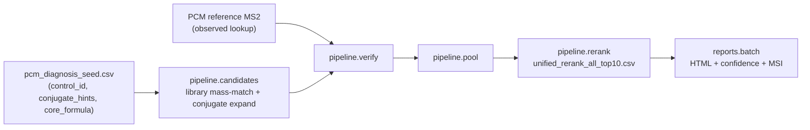

# PCM Structure-Prediction Handoff (run on EC2)

Self-contained instructions for the next agent to predict structures for the
**99 named reference-library metabolites** whose Metabolon super-pathway is
**"Partially Characterized Molecules" (PCM)**, by running this repo's existing
elucidation pipeline on the EC2 box (`ec2-user@10.12.5.28`) where the full library,
spectra, and compute live. Assume no prior context.

## Goal

For each PCM entry (named but structurally unresolved), produce a ranked set of
candidate structures + a calibrated identification confidence + an MSI level,
delivered as the standard per-compound HTML reports. Predictions are **hypotheses**
(expected mostly MSI Level 3): the class + molecular formula + conjugate are known;
the specific isomer/regiochemistry generally is not.

## Why these are tractable (key insight)

They are not blind unknowns. Profiling the reference DB
(`metabolon_super = 'Partially Characterized Molecules'`) shows each entry encodes
its partial characterization in the name, and all are in the global library (they
have reference MS2 spectra):

- 99 entries; only 7 have any SMILES (skip those - already resolved).
- Name patterns parsed by `tools/extract_pcm_tasks.py`:
  - **conjugates (76):** glucuronide 46, glutamine 11, glycine 10, carnitine 5,
    N-acetylglucosamine 2, sulfate 2 - e.g. `"glucuronide of C12H22O4 (3)*"`,
    `"glycine conjugate of C10H12O2*"`.
  - **non-conjugate / formula placeholder (23):** a core formula but no conjugate.
  - **91/99 carry an explicit core (aglycone) molecular formula.**

So structure prediction reduces to: enumerate aglycone cores of the core formula
(library mass-match + de novo), attach the named conjugate, and rank by the
reference MS2 - exactly what `structural_elucidation/pipeline/candidates.py`
(library-anchored + conjugate expansion) already does.

## Pipeline (reuse the existing stages)



This mirrors `run_inference.sh` (per lib: candidates -> verify -> pool -> rerank),
then the report layer (`python -m structural_elucidation.reports.batch`).

## Artifacts already prepared in this branch

- `tools/extract_pcm_tasks.py` - extracts + parses the 99 PCM entries from the
  metabolite DB (stdlib, read-only). Re-run it on EC2 against the full
  `vendor/metabolite_synonyms.sqlite`.
- `docs/pcm/pcm_tasks.csv` - the parsed 99 (chemical_id, name, conjugate,
  conjugate_hint, reaction_available, core_formula, core_monoisotopic_mass,
  isomer_index, has_existing_smiles).
- `docs/pcm/pcm_diagnosis_seed.csv` - the 92 unresolved entries in the
  `control_id / primary_stage / conjugate_hints / core_formula` shape that
  `pipeline.candidates` consumes.

## Key decisions / constraints

- **Reuse, do not rebuild.** Feed PCM through `pipeline.candidates` (it already does
  library mass-match + `CONJUGATE_REACTIONS`/`apply_reaction` conjugate expansion),
  then `verify`/`pool`/`rerank`, then `reports.batch`.
- **Two conjugate reactions are missing.** `structural_elucidation/chemistry/conjugates.py::CONJUGATE_REACTIONS`
  covers glucuronide, sulfate, glycine, carnitine, taurine - but NOT **glutamine**
  (11 entries) or **N-acetylglucosamine** (2). Add SMARTS for these in
  `structural_elucidation/nce/evidence.py::TARGETED_REACTION_SMARTS` + entries in
  `CONJUGATE_REACTIONS`, or those 13 fall back to plain library mass-match (wrong).
- **Hard mass gate applies for free.** The full molecular formula is known
  (core + conjugate), so require candidates to match it - this is exactly handoff
  item 2 in `docs/pipeline_refinement_handoff.md`; the reference prototype is
  `tools/prototype_mass_gate_rerank.py`.
- **Frame as hypotheses.** Cap at MSI Level 3 and order the `(n)` isomers by RT;
  do not claim a single regioisomer. Keep the Metabolon partial name as the anchor.
- **Enhanced reports are already available.** The calibrated confidence, MSI
  badges, candidate-widget evidence surfacing, and mass-alt callout (PR #2) are
  merged into `main`, so this branch includes them - no extra merge needed.

## Ordered steps (on EC2)

1. **Environment.** `cd` to the elucidation workspace (the box where the major runs
   were done). Activate the repo venv (`run_inference.sh` auto-uses `.venv`); ensure
   `rdkit` + `pandas` are installed. Fetch assets if needed (`fetch_assets.sh` pulls
   `vendor/metabolite_synonyms.sqlite`).
2. **Regenerate the PCM task list against the full DB:**
   `python3 tools/extract_pcm_tasks.py --out-dir docs/pcm`
   (confirm ~99 entries; note the glutamine/N-acetylglucosamine "NO_ADD_REACTION"
   count).
3. **Assemble PCM observed MS2 + feature inputs** (the main EC2-specific step - this
   data is not in the report bundle). For the 92 targeted PCM `chemical_id`s, from
   the global spectral library build, per ion mode:
   - an `observed_ms2_lookup` (same schema as
     `data/observed_ms2_lookups/lib{lib}_{ion}_observed_ms2_lookup.csv`),
   - `feature_rows` + `neutral_mass_hypotheses` (precursor m/z, adduct, neutral mass),
   - a per-lib PCM **diagnosis CSV** = `docs/pcm/pcm_diagnosis_seed.csv` filtered to
     that lib/ion mode (add the observed neutral mass column the candidate stage
     mass-matches against).
   Determine each PCM entry's lib/ion mode from where its reference spectrum lives.
4. **(If needed) add glutamine + N-acetylglucosamine reactions** to
   `chemistry/conjugates.py` + `nce/evidence.py` (see the "reaction_available =
   NO_ADD_REACTION" rows in `pcm_tasks.csv`).
5. **Run the pipeline per lib** (adapt `run_inference.sh`; use the PCM diagnosis CSV
   as `--diagnosis-csv` and the PCM controls as `--controls`):
   ```
   python -m structural_elucidation.pipeline.candidates --output-root OUT/pcm_cand_lib{L} \
       --diagnosis-csv docs/pcm/pcm_diagnosis_lib{L}.csv --feature-rows ... \
       --neutral-mass-hypotheses ... --lib-id {L} --ion-mode {ion} --controls <ids>
   python -m structural_elucidation.pipeline.verify  --output-root OUT/pcm_ver_lib{L} \
       --observed-lookup PCM_lookup_{L}.csv --input-candidate-metrics <candidate_metrics_all.csv> \
       --lib-id {L} --ion-mode {ion} --include-all-x
   python -m structural_elucidation.pipeline.pool    --output-root OUT/pcm_pool_lib{L} \
       --scored-candidates OUT/pcm_ver_lib{L}/scored_candidates.csv --lib-id {L} --ion-mode {ion}
   python -m structural_elucidation.pipeline.rerank  --output-root OUT/rerank_pcm_lib{L} \
       --unified-pool OUT/pcm_pool_lib{L}/unified_candidates_per_control.csv --lib-id {L} --ion-mode {ion}
   ```
6. **Generate reports:**
   `python -m structural_elucidation.reports.batch --predictions OUT/rerank_pcm_lib*/unified_rerank_all_top10.csv --observed-lookup-dir <PCM lookups> --out-dir output/pcm_reports --jobs 8`
7. **(Optional) enhanced confidence/MSI** (available on this branch): run
   `tools/enrich_report_evidence.py` -> `tools/patch_report_confidence.py` ->
   `tools/patch_candidate_scores.py` -> `tools/rebuild_master_index.py` over
   `output/pcm_reports`.

## Expected outputs

- `OUT/rerank_pcm_lib*/unified_rerank_all_top10.csv` - ranked candidate structures
  per PCM control (same schema as the X-compound rerank).
- `output/pcm_reports/<chemical_id>/index.html` + master `index.html` - per-compound
  reports with the predicted structure(s), confidence, and MSI level.

## Verification

- **Coverage:** a rank-1 candidate for all 92 targeted controls.
- **Formula correctness:** for a glucuronide case (e.g. `100019984`,
  `"glucuronide of C12H22O4"`), the rank-1 full formula = core + glucuronide
  (C6H8O6, +176.0321), and the observed spectrum shows the diagnostic 176.032
  neutral loss. Analogous diagnostic losses: sulfate 79.957, glycine 75.032.
- **MSI distribution** skews to Level 3 (hypotheses), a few Level 2 where observed
  MS2 strongly corroborates; run `tools/audit_presentation.py output/pcm_reports`.
- **No conjugate silently dropped:** confirm the glutamine/NAG entries produced
  conjugated candidates (else the reactions weren't added).

## Unresolved questions (please confirm)

1. **PCM reference-spectra location + format on EC2** (which library build, path,
   and per-entry ion mode/lib). This is the one input not derivable from the DB.
2. **Non-conjugate / formula-placeholder (23) + no-core-formula (8):** run these
   through constrained de novo (`structural_elucidation/inference/predict.py`,
   Track B, formula-constrained) rather than the library-anchored conjugate track?
3. **Output scope:** full HTML reports (assumed) vs. a ranked SMILES table only.
4. **Isomer disambiguation:** confirm capping at MSI L3 and ordering `(n)` isomers
   by RT (no single-regioisomer claims).
