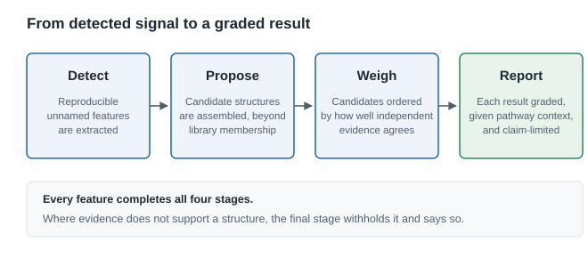
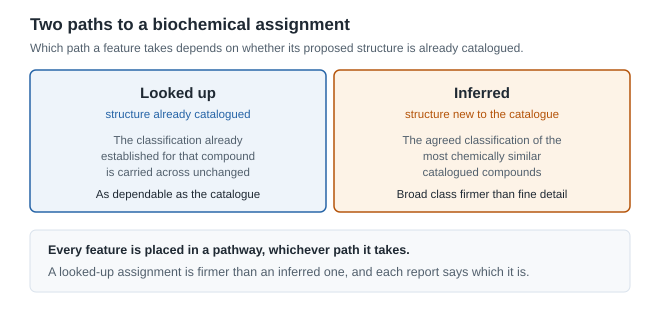
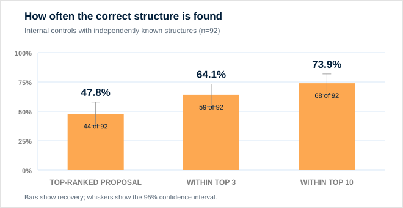
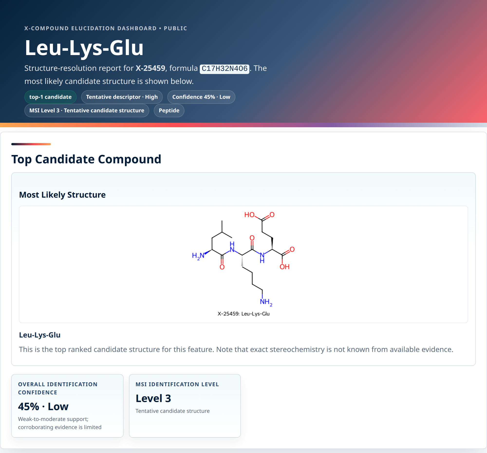
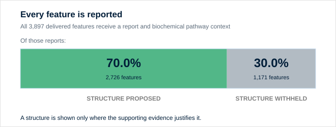

# Structural Elucidation for Unknown Metabolites

**Naming the unnamed: evidence-graded structure hypotheses for untargeted LC-MS/MS features**

**Metabolon, Inc.** — [REQUIRED: contact email] — [REQUIRED: public web URL]

---

## Executive summary

Untargeted metabolomics detects far more molecules than any laboratory can name. The unnamed remainder is not noise: it is reproducible, quantifiable, and often the part of the data most closely tied to the biology under study. But because those features arrive with no structure and no statement of confidence, most analyses set them aside, and the biology they carry is set aside with them.

Metabolon's structural elucidation capability closes that gap. It turns unnamed features into documented structure hypotheses, each carrying an explicit, graded statement of how much evidence stands behind it. Applied to a delivered set of 3,897 unnamed features, it produced a complete evidence report for every feature, proposed a specific structure for 2,726 of them, and deliberately withheld a structure for the remaining 1,171 where the evidence did not justify one.

Three consequences follow for a research team. Nothing is silently dropped from the deliverable, so the unnamed fraction stays inside the biological interpretation. What the workflow declines to claim is as informative as what it proposes, which is what makes the results that are shown worth acting on. And because every feature is graded against the same criteria, results stay comparable across a study, so decisions about where to spend confirmation effort rest on a consistent basis.

## The unnamed fraction of an untargeted dataset

A typical untargeted run yields thousands of reproducible signals. Only a fraction correspond to compounds that have been matched to an authentic chemical standard. The rest are reported as unnamed features: real, measurable, and anonymous.

Setting them aside is expensive in two directions. Biologically, the discarded features frequently include the compounds that differentiate the study groups, so the finding that would have mattered most can be the one never examined. Operationally, the conventional route to naming one of them, in which a chemist interprets the spectra by hand and then buys or synthesizes a candidate to confirm it, is slow enough that it can only ever reach a handful of features per study. The cost is not only the features that go unnamed. It is that the choice of which few to pursue gets made without any consistent basis for comparison.

The alternative is not to guess. It is to produce a defensible hypothesis for every feature and to say plainly how strong each one is, so that a scientist can decide which are worth the cost of confirmation.

## What the established routes cover, and what they leave

Two routes put a name to a signal today. Both work, and what each one covers is what defines the gap between them.

The first is matching an observed spectrum against a reference library. It is fast, well understood, and the most precise answer available short of a standard, which is why it produces the named part of every untargeted deliverable and why it is the first step here too. What bounds it is the size of the catalogue rather than the quality of the match: a molecule that has not been catalogued is outside the space such a search covers, and novel, study-specific chemistry is exactly the chemistry that tends to sit outside it.

The second is expert manual interpretation, followed by acquisition of a candidate compound and confirmation against it. This remains the most authoritative answer available and the proper standard for a settled identity. It is also the scarcest resource in the workflow, which is why it reaches a few features rather than thousands.

What neither route supplies on its own is the thing a study needs in order to triage: a consistent, comparable statement of how much evidence supports each candidate identity. The metabolomics community communicates that through identification levels, which describe the kind of evidence behind a call, from an exact mass alone up to a structure confirmed against an authentic standard. Applying that vocabulary to every unnamed feature in a study, rather than to the few a chemist has time to examine, is the requirement this capability was built to meet.

## What the capability does

Every unnamed feature receives a report. There are no silent omissions and no features that quietly disappear from the deliverable.

*Figure 1. Each stage contributes a distinct kind of evidence, and the final stage decides how much may responsibly be claimed. The confidence grade is produced by the workflow rather than attached to the result afterwards.*

The capability runs in four conceptual stages.

1. **Detect.** Reproducible features and their fragmentation evidence are extracted from the untargeted run, establishing that a signal is real and measurable before anything is claimed about its identity.
2. **Propose.** For each feature, a set of candidate structures is assembled that reaches beyond the compounds a reference library already contains, which is what allows genuinely novel and study-specific molecules to be described rather than skipped.
3. **Weigh.** Candidates are ordered by how well several independent lines of evidence agree with one another rather than by any single measure, so a candidate that looks convincing on one axis alone does not reach the top of the list unchallenged.
4. **Report.** Each result is graded, given biochemical pathway context, and rendered as a standalone report. Where the supporting evidence falls short, the structure is withheld and the report says so.

The value is concentrated in the third and fourth stages. Proposing plausible molecules is comparatively easy. Deciding which proposals have earned the right to be shown to a customer is the hard part, and it is where the capability is deliberately conservative.

**Table 1. What each part of the workflow means for a research team.**

| Capability | Why it matters to you |
|---|---|
| A report for every unnamed feature | The unnamed fraction stays inside the biological interpretation instead of being written off |
| Candidates that reach beyond the reference library | Novel and study-specific molecules can be described, which is often where the differentiating biology sits |
| Several independent lines of evidence combined into one ordering | Reduces dependence on a single evidence source, so one flattering measure cannot carry a weak candidate |
| Grading aligned to community identification levels | Increases transparency and supports more informed prioritization, with no bespoke vocabulary to learn |
| A structure withheld when the evidence is insufficient | Confirmation effort is not spent chasing a structure the data never supported |
| Pathway context on every feature | Extends the biological usefulness of features that fall short of confirmation |
| The same criteria applied to every feature | Enables consistent application at scale, so grades stay comparable across a study and between studies |

## How biochemical context is assigned

Every feature is placed in a biochemical pathway and subpathway, including the features where no structure is shown. That context arrives by one of two paths, and they do not carry equal weight.

*Figure 2. Biochemical context reaches a feature either by lookup against a catalogued compound or by inference from chemically similar ones. The two are not equally strong, which is why every report says which of them produced the call.*

**When the proposed structure is already catalogued.** The classification established for that compound is carried across unchanged, which is what happened for 1,459 of the delivered features. It is a lookup rather than a prediction, so it is exactly as dependable as the reference catalogue and no more.

**When the structure is new to the catalogue.** The classification is taken from the consensus of the catalogued compounds most chemically similar to the proposal, weighted toward the closest matches, because molecules that are chemically alike usually take part in similar biochemistry. That is also why the broad class is firmer than the fine one: fine distinctions turn on exactly the small differences that similarity smooths over. Each assignment carries its own confidence grade, describing the biochemistry rather than the structure, and the report keeps the two apart.

**How well the inferred path holds up.** Hide a reference metabolite's own labels and ask the capability to recover them: across 5,095 reference metabolites it returns the correct broad class 86.7% of the time and the finer subpathway 71.1%. Scored a harder way, against a separate internal label source, agreement is 52.2% and 18.8% across 644 controls. Those two figures are not comparable to each other. The second is scored against a different biochemical vocabulary, one that agrees with the first only 62.5% and 34.8% of the time on identical structures, where any method is right by definition. Read against that ceiling rather than against a perfect score, the broad class holds up about as well under the harder measurement as the easier one, while the finer subpathway genuinely weakens, though far less than the raw figures suggest.

**What that means for using it.** The broad class is usually right and worth acting on. The finer subpathway is a lead rather than a determination, worth checking against your own conventions, since part of any disagreement is vocabulary rather than chemistry. A looked-up assignment is firmer than an inferred one, and each report tells you which you are looking at.

## Evidence that it works

**What was done.** The capability was evaluated against a set of internal controls whose true structures are known independently, so that each proposal could be scored against a known answer rather than against another prediction. A proposal counts as correct when it matches that answer within a fixed structural-similarity threshold.

**What was observed.** On those controls, the correct structure was the single top-ranked proposal 47.8% of the time, appeared within the top three proposals 64.1% of the time, and appeared within the top ten 73.9% of the time.

*Figure 3. The correct structure is usually near the top of a short ranked list, across 92 controls with independently known structures. That is what converts an unbounded chemical space into a shortlist a chemist can work through.*

**What it means.** Two points of context matter when reading those percentages. The control set is modest at 92 compounds and was assembled from the material available rather than sampled at random, so the percentages describe performance on that set rather than a rate that can be assumed for new data. And the results are ranked lists: a top-ten result is genuinely useful because it reduces a boundless chemical space to a short list, but it is not the same as a single settled answer.

**Why it matters to you.** A shortlist that usually contains the right molecule changes the arithmetic of following a feature up. Rather than committing chemistry time to a feature chosen on intuition, a team can work through a small ranked set whose hit rate has been measured.

## What you receive

Each feature is delivered as a self-contained report, with a searchable index across the full set, so the deliverable can be browsed by a biologist and audited by a chemist.

- **The proposed structure and a short list of alternatives**, so that a reviewer sees the runners-up rather than only the winner.
- **The supporting evidence**, including how well the candidate accounts for the observed mass and fragmentation behaviour, so a call can be checked, not taken on trust.
- **Biochemical pathway and subpathway context**, including for features where no structure is shown.
- **An identification level** together with a plain-language statement of what that level does and does not assert.
- **Cross-references** to the independently assigned Metabolon Level, so the new output can be read alongside existing deliverables.

*Figure 4. Every feature arrives as a page like this one, where the proposed structure, the evidence behind it and the grade that limits it sit together, so a reviewer can weigh the call instead of taking it on trust. The example is a demonstration compound rather than a customer result.*

*Figure 5. Across 3,897 delivered features, every one receives a report and pathway context while a specific structure appears only where the evidence supports it. Completeness and restraint arrive together rather than being traded against each other.*

## How to read a result

Results are graded on the confidence-level framework the metabolomics community already uses, so the output is interpretable without learning a bespoke vocabulary.

**Table 2. What each reporting outcome asserts.**

| Reporting outcome | What it means | Reasonable next step |
|---|---|---|
| Confirmed against an authentic standard | The identity is established | Use directly |
| Probable structure | Multiple independent lines of evidence agree | Strong candidate for confirmation |
| Tentative structure | A specific, evidence-consistent hypothesis | Prioritize if biologically interesting |
| Formula-level only | Composition supported; no structure claimed | Treat as an unnamed but characterized feature |
| Mass-level only | The feature is real and quantifiable | Track across studies |

The most important lines in that table are the last two. When the capability cannot support a structure, it does not offer one. Withholding is a designed behaviour rather than a gap in coverage, and it is the reason a structure that is shown carries weight.

For the same reason, the confidence output limits what each report claims rather than stating the probability that a structure is correct. It is worth being precise about the ordering it supports. Within a feature the candidate list is genuinely ordered, which is why working down a short list pays. Between features, the structural grade does not reliably indicate which will turn out to be right, so it should not be the sole basis for choosing what to chase. Biochemical confidence, described earlier, behaves differently and does separate the stronger assignments from the weaker ones. Reporting a hypothesis as a hypothesis is a more useful and more honest product than reporting it as a number that implies more certainty than the underlying evidence can support.

## Where this fits

This capability complements library matching and authentic-standard confirmation rather than replacing either. Matching against the reference library stays the first step and the most direct answer wherever a feature corresponds to a catalogued compound; what this adds is a graded result for the features that fall outside that coverage. It is designed for two situations in particular.

- **Prioritizing discovery.** When a study points to unnamed features, the capability turns each of them into a short, chemically specific candidate list, so the work goes into a handful of named possibilities rather than starting from nothing.
- **Extending reference coverage.** Well-supported hypotheses give a defensible starting point for adding compounds to a reference library, and every addition raises the share of future studies that can be named outright, which is how the two routes compound rather than compete.

Used alongside a reference-library search, the capability contributes additional evidence and reduces dependence on a single evidence source. Used alongside manual interpretation, it enables consistent application at scale. It has not been benchmarked head to head against other computational approaches, and no such comparison is claimed here.

## Conclusion

The unnamed fraction of an untargeted dataset is not a reporting inconvenience. It is unexamined biology, and this capability makes it examinable.

Three points carry the argument. Every unnamed feature receives a documented, graded result. What the workflow declines to claim matters as much as what it proposes, because restraint is what gives the remaining calls their credibility. And the output is an instrument for prioritization rather than a substitute for confirmation: it does not remove the final experiment, it tells you which one to run.

The part of a dataset previously written off becomes a pathway-placed, evidence-graded set of hypotheses that can be scrutinized, followed up, and published.

## Availability

[REQUIRED: describe commercial availability, engagement model, and how a prospective customer initiates a project.]

[REQUIRED: confirm how this capability is positioned relative to existing Metabolon platform deliverables, and whether those deliverables may be named here.]

[REQUIRED: confirm trademark usage, legal disclaimer, and marketing approval before external release.]

Detailed methodology, the full validation analysis, and the accompanying limitations are documented in a separate scientific manuscript available under appropriate agreement. [REQUIRED: state the disclosure process and any confidentiality terms.]

---

*Prepared by Metabolon, Inc. [REQUIRED: document version, date, and approval reference.]*
