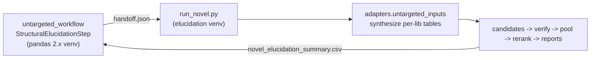

# Untargeted-pipeline integration

This document describes how the structural elucidation stack is attached to the
[`untargeted-pipeline`](https://github.com/MetabolonInternal/untargeted-pipeline)
so that it runs automatically on features that were **not** assigned a
Metabolon/CURATION identity but do have consensus MS2 evidence.

## Overview

The two repositories intentionally do **not** share a Python environment
(elucidation pins `torch==1.12.0` / `pandas<2`; the untargeted pipeline needs
`pandas>=2` / Python 3.11+). Integration therefore runs elucidation
**out-of-process** in its own virtual environment:



The untargeted step writes a neutral **handoff JSON**, invokes
`python -m structural_elucidation.pipeline.run_novel` in this repo's venv, then
merges the resulting `novel_elucidation_summary.csv` back into its feature table.

## Entry point

```bash
python -m structural_elucidation.pipeline.run_novel \
    --handoff /path/to/handoff.json \
    --out-root output/novel_run \
    --jobs 8
```

Key flags:

| Flag | Meaning |
| --- | --- |
| `--handoff` | Handoff JSON produced by the untargeted step (required). |
| `--out-root` | Root for all outputs (required). |
| `--inputs-dir` | Where synthesized input tables go (default `<out-root>/inputs`). |
| `--assets-root` | Root holding fetched model/reference assets (default: repo root). |
| `--stages` | Subset of `candidates,verify,pool,rerank,reports` (default all). |
| `--libs` | Optional comma-separated lib filter (e.g. `400,402`). |
| `--enable-denovo` | Also run encoder de-novo/retrieval inference (needs encoder assets). |
| `--top-k` | Predictions kept per feature (default 10). |
| `--dry-run` | Synthesize inputs and print the planned commands only. |

## Handoff schema

```json
{
  "schema_version": 1,
  "source": "untargeted_workflow",
  "features": [
    {
      "feature_id": 123,
      "lib_id": 400,
      "ion_mode": "positive",
      "parent_mz": 250.09295,
      "ri": 2486.0,
      "peaks": [[67.0, 0.5], [137.05, 1.0]],
      "compound_name": "",
      "prior_match_level": "MS2",
      "prior_matched_name": "some_lib_hit"
    }
  ]
}
```

Only libraries `209, 305, 400, 402` are supported (others are skipped). Each
feature is given a synthetic control id `X-<900000000 + feature_id>` that matches
the `X-\d+` pattern the pool/verify/rerank stages require while never colliding
with real Metabolon X-compounds.

## What `run_novel` does that `run_inference.sh` does not

`run_inference.sh` reuses pre-built `data/base_pools/` for de-novo/retrieval
candidates and assumes registered Metabolon X-compounds. Brand-new untargeted
features have neither, so `run_novel`:

1. Synthesizes `feature_rows`, `neutral_mass_hypotheses`, `gap_manifest`, and a
   bit-exact `observed_ms2_lookup` (NCE ion/loss bins) via
   `structural_elucidation.adapters.untargeted_inputs`.
2. Seeds a synthetic `all_x_catalog.csv` with one dummy `S0` row per library so
   `pipeline.pool` actually writes `unified_candidates_per_control_non_s0.csv`
   (otherwise the split comes out empty and un-truthed novel controls never reach
   the reranker).
3. Tolerates the verifier's non-zero acceptance exit code (expected when there
   are no known winners) as long as `scored_candidates.csv` is produced.
4. Optionally runs `inference.merged` for de-novo/retrieval candidates.
5. Joins `rerank_lib*/unified_rerank_all_top10.csv` back to the originating
   `feature_id` in `novel_elucidation_summary.csv`.

## Outputs

Under `--out-root`:

- `inputs/` — synthesized per-library input tables + `novel_feature_map.csv`.
- `library_anchored_lib*/`, `verifier_lib*/`, `unified_pool_lib*/`,
  `rerank_lib*/unified_rerank_all_top10.csv` — standard stage artifacts.
- `reports/` — per-compound HTML bundles + master `index.html` (when reports run).
- `novel_elucidation_summary.csv` — one row per elucidated feature with
  `feature_id, control_id, lib_id, se_rank1_smiles, se_rank1_score,
  se_topk_smiles_json, se_report_path`.
- `run_novel_summary.json` — per-scope stage status.

## Environment setup

`run_novel` (and every stage it spawns) runs in this repo's venv:

```bash
cd structural_elucidation_jbs
python3.11 -m venv .venv && source .venv/bin/activate    # Python 3.10/3.11
pip install -r requirements.txt && pip install -e .
```

> `torch==1.12.0` / `pandas<2` require **Python 3.10 or 3.11**; they do not build
> on 3.12+. Create the venv with a compatible interpreter.

## Required assets

Fetch the model/reference assets into their canonical repo locations with
`fetch_assets.sh` (see its `--help`), or point `--assets-root` at a tree with the
same layout.

Required for the default `candidates,verify,pool,rerank` path:

- `vendor/modelfiles/` — NCE predicted-spectrum models (`smiles2ms2_models_{lib}*.pkl`).
  Without them the verifier falls back to a portable RDKit fragment-overlap score.
- `vendor/nce/elucidation/table_builders/hmdb_minimal.csv` (+ optional
  `HMDB_36_classyfire_21_annotations.csv`) — library-anchored candidate search.
- `data/nce_full_smiles_candidates.csv` — NCE snapshot candidates (optional).

Additionally required only when `--enable-denovo` is set:

- `models/encoder/best_encoder.pt`, `models/decoder_weights/*.pt`,
  `models/embedding_banks/` and the `SMILES_DB/` retrieval tables.

Optional:

- `vendor/metabolite_synonyms.sqlite` — richer pathway/synonym report detail.
- Open Babel (`obabel`) — nicer 2D structure rendering in reports.
