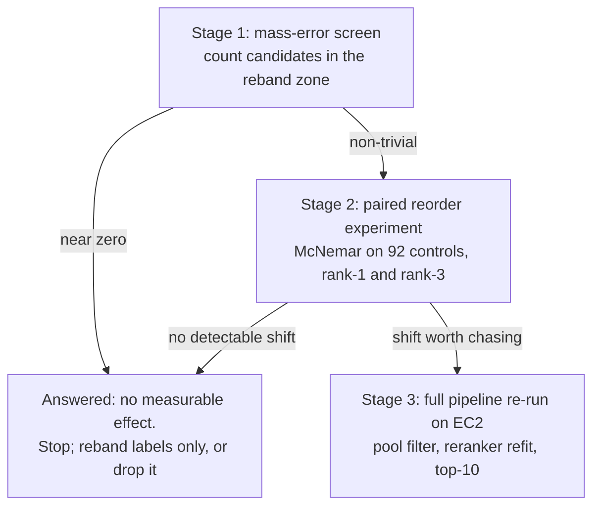

# Measuring the impact of a mass-policy change

Status: proposal, not started. Nothing in this document has been implemented.

Origin: the drafted parameter sheet `20260803 Evidence Score Ranges and Descriptions.xlsx`
gives Mass Match bands of 0-1 ppm Strong, 1-3 ppm Acceptable, 3-5 ppm Borderline.
Those bands are not what the code implements. This plans the work that determines
whether adopting them would change any result, which is a prerequisite for
deciding whether to adopt them at all.

Related: the parameter table that documents the current bands is Supplementary
Table S10, generated by `tools/build_parameter_table.py`.

## What this plans

The work that answers "would the spreadsheet's ppm bands change our results" —
not the rebanding itself. The rebanding is gated on stage 1 and should not be
attempted before it.

## The finding that reframes it

`docs/pipeline_refinement_handoff.md` lines 52-59 already audited the mass
failures, and they are not tolerance failures:

- Rank-1 mass errors are **not borderline**. 308 of 590 are at or above **5 Da**,
  and the **median nonzero error is about 176 Da** — glucuronide scale. The deltas
  cluster on real conjugates: hexose 162.053, glucuronide 176.032, sulfate 79.957.
- **248 of 590 have a blank formula** on the rank-1 SMILES, so no mass could be
  computed and `mass_match` defaults to 0.
- The document states it directly: "A looser mass tolerance cannot rescue a
  162/176 Da gap."

A candidate off by 176 Da is off by roughly 590,000 ppm. It scores 0.0 under a
5 ppm window and 0.0 under today's 16.7 ppm window alike. Tightening the window
can only reclassify candidates whose error falls **between** the two windows —
roughly 0.0015 to 0.005 Da at 300 Da. Nothing in the audited mismatch cohort is
described as living there.

So the likely answer is that almost nothing moves, and stage 1 is designed to
confirm or refute that in minutes rather than assume it.

## Why the change is not reporting-only

`mass_match_score` touches ranking in four places, which is why this needs
measuring rather than eyeballing:

- A hard pool filter dropping any candidate above tolerance
  (`structural_elucidation/utils/merge.py:83`)
- The SELFIES pool merge score, weighted **0.55** — the dominant term
  (`structural_elucidation/utils/merge.py:22`)
- A supervised reranker feature and a sort tiebreaker
  (`structural_elucidation/pipeline/rerank.py:43`, `:459`)
- The heuristic fallback score, weighted **0.22**
  (`structural_elucidation/pipeline/rerank.py:440`)

Plus the confidence axis at weight 0.30, which is reporting only.

## Staged, each stage gating the next

## Stage 1: the screen

A new `tools/audit_mass_policy.py`, read-only, pure standard library, following
the shape of `tools/prototype_mass_gate_rerank.py`. It walks a report bundle and,
per candidate, reads `abs_mass_error_da` and `observed_neutral_mass` from
`<slug>_candidate_score_summary.csv`. `structural_elucidation/reports/confidence.py`
lines 1075 and 1757 confirm both are carried per candidate, which is what makes
re-scoring possible at all rather than only re-reading the lossy score.

It reports:

- The distribution of per-candidate mass error in ppm, computed against each
  candidate's own observed neutral mass rather than a nominal 300 Da, bucketed
  finely below 20 ppm and coarsely above.
- **The headline number: how many candidates, and how many rank-1 candidates,
  fall between the proposed window and the current one.** If that is near zero,
  the question is answered and stages 2 and 3 are unnecessary.
- How many candidates change band under the proposed rule, split by whether they
  would cross `MASS_STRONG` (0.90) or `MASS_WEAK` (0.50), since those two gate
  MSI Level 2 and the Tentative demotion respectively.
- A count of blank-formula candidates, which no tolerance change can affect.

Output `docs/paper/data/thresholds/audit_mass_policy.json` plus a `.md`, matching
the `indent=2` and Markdown-table conventions of `tools/audit_thresholds.py`.

## Stage 2: the paired reorder experiment

Only if stage 1 shows a non-trivial population. Extends the same tool with a
`--rerank` mode.

- For each report, re-order the delivered top-10 from `<slug>_top_candidates.csv`
  under an alternative mass policy, then recompute correctness as
  `truth_tanimoto >= 0.70`, which is how `tools/audit_structure_predictions.py`
  lines 165-169 defines it.
- On the 92 truth controls, compare correct-before against correct-after as a
  **paired** test: count discordant pairs and run an exact two-sided binomial
  (McNemar). Implement with `math.comb` rather than adding scipy, matching the
  repo's hand-rolled Wilson intervals.
- Sweep the tolerance over a grid rather than testing 5 ppm alone. Picking 5 ppm
  because a spreadsheet says so repeats the mistake of 0.005 Da being unexamined.
  A flat curve is a real finding and matches what `tools/audit_thresholds.py`
  already concluded about the score cutoff.
- Recompute the MSI and tier distributions over all 3,897 reports, which is where
  any effect will actually show.

**Two limits to state in the output, not discover later.** Reordering a fixed
list of ten cannot change top-10 recovery, so that metric is out of scope here.
And the pool filter at `structural_elucidation/utils/merge.py:83` drops
candidates before they ever reach a report, so delivered data cannot show what a
tighter tolerance would have discarded. Stage 2 measures reordering only.

## Stage 3: full pipeline re-run

Only justified if stage 2 shows a shift worth chasing. This is the only way to
measure the pool filter, the supervised reranker's response, and top-10 recovery.
It needs the EC2 environment in `docs/ec2_export_handoff.md` and a re-fit of
`PLATT_A` / `PLATT_B` via `tools/calibrate_confidence.py`, plus a re-run of every
audit and both documents.

Worth knowing before funding it: the reranker is refit each run as a
`GradientBoostingClassifier` (`structural_elucidation/pipeline/rerank.py`), and
tree ensembles are invariant to strictly monotone transforms of a single feature.
A pure rescaling of the mass score is largely absorbed there. The parts that
genuinely move are the pool filter and the two linear scores, weighted 0.55 in
`structural_elucidation/utils/merge.py` and 0.22 in the heuristic fallback.

## Constraints

- **All three stages need the report bundle.** This checkout has no
  candidate-level data: the committed `docs/paper/data/structure/audit_structure_controls.csv`
  is rank-1 only and carries no axis columns, which is also why `msi_rule` in the
  committed threshold audit reads `not_evaluated`.
- **The new tool cannot join the CI regenerate-and-diff set** for the same reason.
  It belongs with the controlled-input audits orchestrated by
  `tools/rebuild_paper_artifacts.py`, not with the derived analyses.
- **Detectability on 92 controls.** One control is 1.09 points; rank-1 recovery is
  47.8% with a 37.9-57.9% interval. Two independent intervals could not resolve
  anything smaller than about ten points, which is why stage 2 must be paired.
- Do not change `mass_match_score` while measuring it. Stage 2 applies alternative
  policies as a parameter, leaving the shipped scorer untouched.

## Verification

- Unit-test the ppm conversion and the band-crossing classifier against
  hand-worked values, and the exact McNemar against a known table, in
  `tests/test_mass_policy.py`.
- Assert stage 1 on the bundle reproduces the already-audited figures as a sanity
  check: 598 rank-1 mismatches, 15.35% mismatch rate, 523 recoverable. If it does
  not, the tool is reading the bundle wrongly and nothing downstream is
  trustworthy.
- `ruff check tools/audit_mass_policy.py tests/test_mass_policy.py`.

## What to do instead, if the goal is better numbers

If the actual aim is moving the bottom line rather than settling the spreadsheet,
the ppm rebanding is not the lever. Item 2 in
`docs/pipeline_refinement_handoff.md` is: a hard mass gate that stops a
mass-inconsistent candidate holding rank 1 when a mass-consistent one sits below
it. That is quantified at **523 of 598 reports recoverable**, has a working
read-only prototype in `tools/prototype_mass_gate_rerank.py`, and is orthogonal
to how the bands are labelled. Stage 1 of this plan produces exactly the evidence
needed to compare the two.

## Unresolved questions

- **Does this mean measure or implement?** This plans the measurement, because the
  impact is unknown and the handoff evidence suggests it is near zero. Implementing
  the ppm rescoring regardless of measured impact is a pipeline change across
  candidate generation, pooling, reranking and reporting, and it invalidates the
  Platt calibration and every audited number in both documents.
- **Is there a bundle available to run against, and where?** Every stage needs one.
  If none is reachable, stage 1 cannot run and the honest position stays what it is
  now: the spreadsheet's window is more defensible for high-resolution data than
  the current 16.7 ppm equivalent, and its effect on results is unmeasured.
- **Should the sheet's 5 ppm be treated as fixed, or swept?** This plan sweeps. If
  5 ppm is a firm instrument-driven decision rather than a drafting choice, stage 2
  collapses to a single comparison.

## How to dispatch this

**Do not fan this out in parallel.** The stages gate each other on purpose: stage 1
exists so that stages 2 and 3 can be skipped, and running them concurrently spends
exactly the effort the gating is there to avoid. Task 2 decides whether tasks 3, 4
and 6 happen at all.

Only two tasks are safely concurrent, and only after task 1 has fixed the
interface: task 5 (the unit tests for the ppm conversion and the exact McNemar)
can be written alongside task 3, since it tests pure functions and needs no bundle.

Everything except task 2 can run without a report bundle. Task 2 cannot, and it is
the one that produces the answer.

## Task list

1. Write `tools/audit_mass_policy.py`: walk a report bundle, compute per-candidate
   ppm error from `abs_mass_error_da` and `observed_neutral_mass`, and report how
   many candidates sit between the proposed and current windows.
2. Run the screen against a bundle and check it reproduces the known 598 / 15.35% /
   523 figures. If the reband population is near zero, stop and report that the
   question is answered.
3. If the screen warrants it, add `--rerank`: reorder each delivered top-10 under
   alternative mass policies, sweep the tolerance, and run an exact paired McNemar
   on the 92 truth controls for rank-1 and rank-3.
4. Recompute MSI level and confidence tier distributions over all 3,897 reports
   under each swept policy.
5. Add `tests/test_mass_policy.py` covering the ppm conversion, the band-crossing
   classifier, and the exact McNemar against a known table.
6. Write the result to `docs/paper/data/thresholds/audit_mass_policy.json` and
   `.md`, stating the two scope limits.
